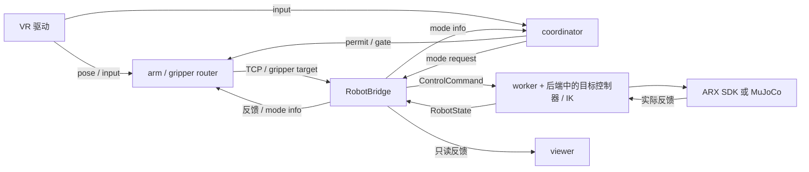

# 从 arx 原链路校正组件边界

日期：2026-09-29。此次复核直接阅读 arx-televr 的 Python 实现，以及 `native/rollio-source.tar.gz` 中的 XRobot 和 teleop-router/coordinator Rust 源码。最初复核记录如下；同日已按这些边界完成运行代码拆分，实施结果见末尾。

**复用的基础应是 arx 已有的组件边界、接口和状态机。** 整体导入保证来源完整；在此基础上，插件接口应对应原链路的实际职责。复核时的 `vr.arx.quest` 曾把多项职责包在一起；目前已拆开设备、路由、命令入口与会话。

## 原版已经怎样解耦

| 原有部件 | 输入 → 输出 | 负责什么 |
| --- | --- | --- |
| `rollio-device-xrobot` | PC Service SDK 回调 → pose/input topic | SDK 生命周期、坐标基变换、连接/追踪状态、原始按键与序号。没有机械臂 SDK 或 IK。 |
| `rollio-teleop-router coordinate` | 按键、成员实际模式、route health → mode request、permit、gate、夹爪意图 | 模式状态机、组合键、离合与许可，等待后端实际模式确认。 |
| arm router | 输入位姿 + 机器人反馈 + gate → TCP 目标 | 相对参考、平移比例、旋转参考系、输入/反馈年龄。接收真实反馈建立参考。 |
| gripper router | 夹爪意图 + permit + 反馈 → parallel 命令 | 独立的夹爪通道、许可、新目标边界和超时。 |
| `ipc/RobotBridge` | 原生命令 ↔ `ControlCommand` / `RobotState` | wire 类型、模式数值、主题发布/订阅；不做 IK，不调用 SDK。 |
| `worker.py` | 命令与反馈 → 周期执行 | 250 Hz 调度、反馈检查、生命周期、诊断与退出。 |
| `JointTargetController` / `X5Model` | 模式/TCP/反馈 → 关节目标 | Home、FreeDrive、保持、IK seed、目标限位与逐 tick 更新；FK/IK 使用同一模型。 |
| `RealBackend` / `MujocoBackend` | 相同上层契约 → 硬件或仿真执行及反馈 | SDK 数据包/动力学、增益、夹爪和后端资源。两者使用相同目标控制器。 |
| `viewer.py` | 反馈 topic → 渲染 | 自己的 MuJoCo data 与显示周期，通过订阅获取状态。 |

逻辑关系如下。控制器由后端持有，与 worker 同进程；图中的功能边界不等于每个节点都新增一个进程。

直接依据：[`native_config.py`](../control/arx5_vr/native_config.py)、[`RobotBridge`](../control/arx5_vr/ipc/__init__.py)、[`model.py`](../control/arx5_vr/model.py)、[`real.py`](../control/arx5_vr/real.py)、[`sim.py`](../control/arx5_vr/sim.py)、[`INTERFACES.md`](../control/docs/INTERFACES.md)。这些文件已随 arx 导入本仓库。

## 值得沿用的细节

**数据、指令、许可和确认分别传递。** 原配置明确区分 `states/*`、`commands/*`、`control/mode`、`info/mode`、`permit/gate/health`。coordinator 根据实际 mode info 和 route health 决定许可。网络接收 ACK、控制模式生效和运动完成是不同事实，工作台要保留这些区别。

**状态机和 I/O 分开。** Rust `CoordinatorState` 产出 `CoordinatorEffect`：设置许可、发布 gate、设置成员模式等；外层运行时处理具体消息。新增手势、按钮和任务动作可以沿用这种“事件 → 状态转移 → 明确效果”的结构，便于注入时钟和消息做离线验证。

**重连后的参考与新鲜度是接口契约。** coordinator 的 `ControllerInputTracker` 拒绝重复/回退序号刷新健康时间；gripper 路由的 `PermitLatch` 维护新许可对应的目标边界。XRobot SDK 回调进入有界队列，检测到队列丢失会发布无效输入。不能仅凭某个 socket 还连着就认为输入有效。

**设备坐标与遥操映射分层。** XRobot 驱动执行 `xr_basis` 坐标变换，arm router 执行相对映射。替换 VR 只在设备适配层完成基变换；不能在新 mapping 插件中再变换一次。手机原有 tool/base 相对映射同样要明确转换发生在哪一层。

**输入帧率与控制周期独立。** `RobotBridge` 消费最新命令，`JointTargetController` 缓存完整目标；即使 VR 帧稀疏，关节目标仍按 250 Hz 更新。优化输入、渲染或记录频率，不应改变设备循环的时钟所有权。

**仿真替换执行介质，保留上层行为。** real/sim 采用相同 `ControlCommand`、`RobotState`、目标控制器和模型接口，能比较同输入下的输出。原 `RealBackend` 已有 `controller_factory(config, kinematics)` 注入点；复核时 sim 构造器直接创建 `JointTargetController`；本轮已补齐相同的 `controller_factory` 注入点，默认仍使用原控制器。

**装配与参数分域。** `app.py` 负责组合进程，`settings.py` 分开读取 robot/vr 配置，`native_config.py` 生成本次运行的主题连接和参数。夹爪最大宽度从机器人配置传给遥操装配，这属于显式依赖，不需要通过“彻底独立”消除它。

Rust 源码依据均在已导入的 [`rollio-source.tar.gz`](../control/native/rollio-source.tar.gz) 中：

- `vendor/rollio-reference/robots/xrobot/src/bin/device.rs`：`run_live`、`publish_controller_sample`、`publish_queue_drop_safety_floor`。
- `vendor/rollio-reference/teleop-router/src/coordinator.rs`：`ControllerInputTracker`、`CoordinatorEffect`、`ready_inputs_and_routes`、`compute_permit`。
- `vendor/rollio-reference/teleop-router/src/lib.rs`：`FollowerModeGate`、`PermitLatch`、`TimestampTracker`。

原生源码快照与交付二进制未做逐字节可重现构建验证；源码用于核对设计，不据此新增二进制行为验收结论。

## 复核时发现的问题与修正依据

| 复核时的代码 | 复核结论 | 应沿原边界调整的位置 |
| --- | --- | --- |
| [`NativeQuest`](../control/adapters/sources.py) 同时启动 input/coordinator/两个 router，并在 worker 中读取 XR 做接管门控 | `vr` 插件粒度过粗，混入了整条管线编排和控制权逻辑 | VR 适配负责发布输入；coordinator/router 复用原部件；管线组合由 supervisor/profile 完成；owner 门控属于命令入口。 |
| [`NativeVR`](../src/component_api/contracts.py) 同时要求 `start_pipeline` 和 `poll` | 一个接口跨了进程装配与周期消费两个生命周期 | 分开表达输入设备、路由、命令入口的窄接口；保留组合启动的便捷入口。 |
| [`workbench`](../src/workstation/workbench.py) 按 `source == 'quest'` 选择原生输入，所有 profile 都解析 VR 插件 | 插件名称承担了隐式依赖声明 | profile 声明需要的输入/路由组件；普通 CLI/手机组合只装配实际需要的部分。 |
| [`worker`](../control/arx5_vr/worker.py) 和 [`CommandEngine`](../control/adapters/commands.py) 直接判断 Quest 来源 | 控制调度和裁决仍知道具体输入设备 | 输入适配提交带来源/新鲜度的候选命令；公共裁决处理 owner、epoch 和有效期。设备按键语义留在设备/协调层。 |
| [`QuestSource`](../src/inputs/idle.py) 实际只维持 lease | 控制权会话与 VR 数据生产者需要在命名和契约上区分 | 明确 input device、teleop session 和 active owner 是三个角色，避免再次给 worker 引入设备职责。 |
| [`app.py`](../control/arx5_vr/app.py) 在 managed 模式把所有原生子进程退出都视作 optional | 故障隔离应与活动路由依赖联动 | 非活动 Quest 故障不打断手机；活动 Quest 必需的输入/coordinator/router 故障应撤销该路由许可，并验证停止/保持边界。复用现有 health/permit 闭环。 |

最后一项是复核时的验证缺口：已有多源验收覆盖 CLI → phone → handeye，但没有验证 managed Quest 活动时分别退出 coordinator/arm/gripper 的行为。现有门控检查 XR 新鲜度不能代替 route health；不能把非活动组件退出的独立性测试等同于活动 Quest 故障验收。

## 校正后的复用原则

1. arx 的 VR 驱动、协调、路由、桥接、目标控制和执行后端分别作为边界依据，保留现有实现和时序。
2. 插件注册表负责选择实现，profile/supervisor 负责连接部件；无需让每个内部函数都成为插件或服务。
3. 新手机、标定、策略可在适合自身语义的目标入口接入，普通 Quest 沿用原链路。一个输入只做一次坐标转换和相对映射。
4. 只对确有独立替换需求的边界补适配；实现新 IK 优先使用 `solve_ik` / `controller_factory`，实现新输入优先对接已有 topic/输入契约。
5. 组件可独立优化，同时保留它依赖的反馈、模式确认和健康闭环。增加多源 owner 时，要显式组合这些状态约束。

## 已落实的代码边界

- [`composition.py`](../control/adapters/composition.py)：`QuestDevice` 只声明原生输入进程；`NativeRouting` 启动原 coordinator 与 arm/gripper router。输入与路由可分别选择，原坐标变换、映射和模式状态机保留。
- 原 `RobotBridge` 增加命令/反馈端口选择，默认完整行为保留。worker 始终发布反馈；无 VR 的手机/CLI 运行仍可连接原只读 viewer。
- [`NativeIngress`](../control/adapters/sources.py)：只在 worker 中消费原 `RobotBridge`、输入、permit 和 route health，产出带 epoch/期限/输入序号的候选命令。没有启动进程、获取租约或求解 IK 的职责。
- [`commands.py`](../control/adapters/commands.py) / [`gateway.py`](../control/adapters/gateway.py)：租约显式绑定 `ingress`，来源名称仅标记数据。裁决先处理当前 tick 的控制权变化，再取候选；过期或旧 epoch 候选不能跨接管边界。RPC 跟随数据由显式 `purpose=teleop` 标记。
- [`NativeSession`](../src/inputs/idle.py)：只申请和维持入口租约，和 XR 数据生产者分开。取消原生会话后保持到释放/重新申请；该租约不能混入 RPC 运动。
- [`workbench`](../src/workstation/workbench.py)：profile 的 `native` 声明 device/routing/ingress/channel；CLI/手机不再解析或创建 VR。原生 source 通过能力声明要求入口连接，公共装配不判断 Quest 名称。
- `controller.arx.joint_target` 通过原有注入点在 real/sim 中选择；调优日志中的 IK 专用诊断为可选字段，不要求替代控制器实现原控制器的私有变量。

活动入口检查 supervisor 心跳、输入时间与递增序号、原 coordinator permit 心跳和原 route health。进程退出或已就绪入口失去健康时，worker 撤回其 owner、清参考并反馈保持；其他入口的 owner 不受影响。初次等待头显数据时只保持；追踪恢复后须显式重新申请会话；若 coordinator 正等待 Disabled 确认，需操作者 A+B 回 Home 完成同步，再进入跟随。进程已退出则需重启 runtime 才能恢复该管线。没有在故障后自动重连或自动 Home。原 `Disabled` 的 Home 只接受当前 epoch 的 A+B 请求。

联调还发现原生程序对全局 `control/events` 容量的创建竞争。装配先等 coordinator 发布首个 permit，确保其端口已创建，再启动 router；不修改原生二进制。工作台等 `runtime.ready` 后才启动 source，避免把 backend.ready 当作整组组件就绪。

真实原生进程、合成 XR 与 MuJoCo 故障测试脚本为 [`check_native_components.py`](../control/scripts/check_native_components.py)。测试分别终止/挂起必需组件、检查活动撤权与无隐式 Home、检查非活动原生组件故障不影响 RPC owner；测试产物和完整回归范围见 [实施记录](arx-runtime-implementation.md)。未新增真实硬件验收结论。
