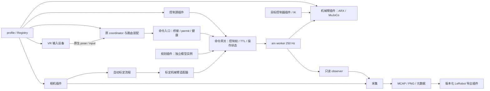

# 插件工作台

三个参考仓库的扩展算法、设备及操作已集中迁入，使用 `./run.sh components list` 查看；代码位置、环境和独立操作边界见 [合并后的组件说明](consolidated-components.md)。本页描述共用 arx gateway 的原生工作台。

代码、模型、原生程序、iOS App 和来源记录均在 ThoughtIntoAction 内。控制内核复用 `control/` 中的 arx-televr：原 Quest coordinator/router、映射、IK、SDK 和 MuJoCo 仍是主实现。插件解决外围装配、替换和独立验证。

原 arx 已分开 VR 驱动、coordinator、arm/gripper router、IPC 桥接、目标控制器与后端。本轮插件接口沿用这些边界：设备进程与路由由 supervisor 装配，命令入口在 worker 内消费，租约由独立会话持有。源码依据、启动容量问题与修正见 [arx 组件复核](../architecture/arx-component-review.md)。

## 部件与依赖



| 插件类型 | 当前实现 | 运行环境与接口 |
| --- | --- | --- |
| `robot` | `arx.sim`、`arx.real` | Python 3.10；`factory(config, **options)` → `read_state/step/telemetry/close`，由 worker 唯一持有 |
| `vr` | `arx.quest`、`arx.demo` | supervisor；`validate/commands` 只负责输入进程和原 pose/input ABI，demo 仅限仿真 |
| `routing` | `arx.native` | supervisor；`commands/start` 装配原 coordinator、arm/gripper router，保留独立配置及进程 |
| `ingress` | `arx.native` | worker；`poll/close`，消费 bridge/permit/health 并产出带 epoch、期限的候选命令 |
| `controller` | `arx.joint_target` | real/sim 相同 `factory(config, kinematics)` 注入；使用原目标控制器与 IK |
| `source` | `cli`、`quest`、`phone.arkit` | Python 3.12；`factory(directory, **options).run()`；CLI 待机不占控制权；Quest 是 `NativeSession` 租约管理，手机拥有 UDP 输入并显式续租 |
| `input` | 新 `arkit` 及旧输入 | 原始报文、session、序号、追踪状态；`start/latest/stop` |
| `mapping` | `phone_tool`、`phone_base` | 原相对位姿算法；活动映射在抓取参考时锁定 |
| `planner` | `motion.default` | Python 3.10；`factory(config, model_id).plan(request, snapshot, now)`，独立的可变 IK 数据 |
| `camera` | `realsense`、`synthetic` | Python 3.12；上下文生命周期、`metadata/read()`；RealSense 沿用独立共享相机服务 |
| `exporter` | `schema1`、`schema2` | 独立 LeRobot 环境；`prepare/save_sidecar`，数据只能选择 schema，不能指定 Python 工厂 |

注册表统一在 `configs/plugins.json`，加载器为 `embodied.contracts.registry`。接口、设备锁和客户端共用 `src/embodied/contracts/`；调用者已迁到新位置。`api_version=1` 和 `runtime=workstation/control` 在加载前检查，列举、校验 profile 不导入硬件 SDK。控制端只读 JSON，避免向 Python 3.10 引入 Python 3.12 的依赖。

当前机器人协议明确是六轴 X5 + 米制夹爪，替换驱动须满足同源 X5 模型契约。其他轴数/机械臂需要新协议版本及对应模型运行时；注册名称不代表已经支持其他硬件。控制权、有效期、反馈检查保留在公共执行边界，各输入插件不能绕过它们。

独立优化的位置：VR 驱动改设备工厂/输入 ABI；原协调和相对映射沿用 native 配置与代码；接管/健康门控改 ingress；目标控制改 controller；手机映射改 `inputs`/mapping 工厂，规划改 `planner`，相机驱动改 `camera`，录制改 `collection/episode_io`，对齐改 `observations`，导出改 `dataset_tools`。它们均不需要复制一套机械臂 SDK 或改动原 Quest IK。

## 先在仿真中使用

```bash
./run.sh workbench plugins
./run.sh workbench validate --profile sim-manual
./run.sh workbench start --profile sim-manual --headless
```

原生组件由 profile 显式连接，例如 `sim-quest.json`：

```json
{
  "version": 1,
  "robot": "arx.sim",
  "controller": "arx.joint_target",
  "source": "quest",
  "native": {
    "device": "arx.quest",
    "routing": "arx.native",
    "ingress": "arx.native",
    "channel": "native"
  },
  "camera": "none"
}
```

省略 `native` 就不创建 VR/路由/命令入口，手机和 CLI profile 即采用此方式；worker 的反馈发布始终保留，原只读 viewer 仍可连接。`source_options.ingress` 与 `native.channel` 显式对应；替换 source 名称无需改 worker。`sim-native-demo` 将设备替换成合成输入，原生路由、命令入口、目标控制器和 MuJoCo 仍真实运行：

```bash
./run.sh workbench start --profile sim-native-demo --headless
```

该 demo 从 managed 保持模式出发，复用原示例位姿并调整一次模式切换按键；普通 unmanaged demo 完全保留。

启动输出本次 `outputs/runtime/control/<目录>`。后续命令用它替换 `<RUN>`，不要连接历史运行。

```bash
./run.sh workbench status --run <RUN>
./run.sh motion --run <RUN> jog --joint 1 --step 0.03
./run.sh motion --run <RUN> preview --q 0 0.6 1 0 0.2 0 --output /tmp/plan.json
./run.sh motion --run <RUN> execute --plan /tmp/plan.json
./run.sh motion --run <RUN> gripper --width 0.04
./run.sh motion --run <RUN> teach --output /tmp/point.json
./run.sh motion --run <RUN> return --point /tmp/point.json
./run.sh motion --run <RUN> free-drive --duration 5
./run.sh motion --run <RUN> home
```

`movej --q ...`、`movel --pose x y z qx qy qz qw` 直接完成预览、提交、等待。`preview` 不获取控制权；计划有效期 30 秒，执行核验模型、owner epoch、起点与速度。已有文件不会被覆盖。操作返回 ID，可从 `status` 查询 running/completed/cancelled/failed；Ctrl+C 取消当前操作并释放控制权。

MoveJ 使用共享 Ruckig 轨迹。MoveL 使用所选机器人的 IK、样条连接关节路径、时间拉伸及离散速度/加速度/jerk 检查；奇异点附近可能明显变慢或拒绝。速度、加速度、jerk、TCP 约束与到位条件统一在 [`configs/control/motion.json`](../../configs/control/motion.json)，含义见 [运动参数](motion-settings.md)。单计划最长 60 秒。当前不提供碰撞检测；预览明确返回 `collision_check=none`。

### 手机与切换来源

启动手机组合：

```bash
./run.sh workbench start --profile sim-phone --headless --record-task "手机检查"
```

`sim-phone` 默认 UDP 127.0.0.1:5005，用于本机协议验证。连接真手机时，在自己的 profile 中设 `source_options.bind_host` 为 PC 可访问地址或 `0.0.0.0`，App 填 PC 地址、端口。App 源码在 `apps/ios`，目前为 iOS ARKit，按其 README 用 Xcode 构建。没有 Android/手机网页实现；现有 UDP 协议没有认证层。

同一设备运行切换来源：使用 `sim-manual` 启动常驻控制，另一个终端运行所需源；结束源后再启动下一源。

```bash
./run.sh phone --run <RUN> --bind-host 0.0.0.0 --port 5005
# Ctrl+C：手机退出，机械臂保持当前反馈位置；可接着运行 motion / handeye。
./run.sh phone --run <RUN> --port 5006 --ghost
```

若要在同一运行中切换至 Quest，最初用 `control start --backend sim --input quest --managed --headless` 启动原生输入管线，然后用 `component-source --run <RUN> --plugin quest` 申请 Quest 控制权。停止这个源进程只释放租约，不关闭原生管线；手机可随后接管。`workbench start --profile sim-quest` 自动完成这两步。

接管后需先释放 Grip/Clutch，再激活。手机断流/追踪恢复保留原重新激活流程；原生入口已就绪后若失去健康，会撤回租约，需要重新运行 `component-source` 申请控制权，再松开 Grip 并激活。手机每个有效新帧只提交一次目标；重复 UDP 不刷新目标期限。原工具映射保留 `[手机 y, -手机 x, 手机 z]`、平移倍率 2；另可选 `--mapping phone_base`。手机夹爪 0 闭、1 开，转换为米；松开 Clutch 后仍可调整夹爪。Recenter 按边沿重新建立参考。

SettingsAck 返回接受的比例；平移倍率最大 3，新比例在下次建立参考时生效。Home 是单独的预览轨迹。ESTOP 请求锁存整个运行的停止，RESET ACK 返回拒绝，须显式重启运行；不会以网络复位解锁 SDK。手机 joint-zero 请求明确拒绝并终止该源，不拿它代替电机零位标定。

### 控制权与故障边界

Unix 命令 socket 权限为 0600，与只读 observer 分离。每次接管生成 token/epoch；消息校验 runtime、递增 sequence 和本机时间，最多 8 个连接、64 条排队、每 tick 8 条请求。JSON、socket、文件写入、规划均不在机器人周期中运行。

租约 500 ms；客户端每 100 ms 续租。目标有效期 20–250 ms，从发送时间计算，心跳不延长旧目标。失效、释放、取消进入基于反馈的位置保持并清理 IK 参考，不自动 Home；接管需速度低于 0.05 rad/s。真实 worker 停止按 arx 执行 SDK 阻尼，仿真退出沿用上游停车归位。软件停止 ACK 不表示物理运动已经完全停止。

租约绑定 `ingress=rpc` 或 profile 声明的通道，而非来源名称；普通 RPC 遥操显式使用 `purpose=teleop`。网关先处理本 tick 控制权请求，再读取匹配 epoch 的候选，过期候选不能跨接管边界。原生租约只接受续租、释放、保持/取消；运动操作先释放该租约再通过 RPC 获取控制权。保持/取消会暂停该入口至重新申请。

原生依赖心跳每约 50 ms 发布，worker 的超时为 200 ms；原 XR 输入和 coordinator permit 检查 100 ms，route health 检查 500 ms。时间戳和递增序号共同防止历史/重复数据续命。必需进程退出或活动入口失去健康后撤销 owner、清除参考并保持，`status.last_revocation` 和 `status.ingresses` 显示原因。非活动原生组件故障不会打断手机/CLI；不会自动重启故障组件。活动故障保持不等于物理瞬间静止。Home 保留 arx 语义，managed 原生入口只允许本次 owner 的 A+B 发起，避免转发非活动 coordinator 遗留的 Disabled。如果 coordinator 在断流期间进入等待 Disabled 确认，重新连接后须由本次操作者按 A+B 显式回 Home 并完成模式同步，再用 A 进入跟随；仅松开 Grip 不会代替模式确认。原生进程已退出时需重启 runtime 后再使用该管线，单独重启租约源不能恢复死掉的进程；原运行中的手机/CLI 仍可继续。

`workbench stop --run <RUN>` 请求整个运行停止。工作台 Ctrl+C/SIGTERM 按“采集 → 输入源 → 控制”顺序清理；viewer/observer 退出不关闭机器人。首版录制不跨 owner epoch，先停录再换源，否则条目标记失败。

## 相机、采集与导出

```bash
./run.sh collect --run <RUN> --camera synthetic --task "仿真示教" --duration 10
./run.sh collect --run <RUN> --camera wrist --task "真实示教"
./run.sh runtime-data validate outputs/datasets/runtime/<episode>
./run.sh runtime-data alignment outputs/datasets/runtime/<episode>
bash scripts/datasets/convert.sh --source outputs/datasets/runtime/<episode> --output outputs/datasets/lerobot/<new-name>
```

`--camera-options` 接受 JSON 构造参数；profile 可用 `camera_options`。真实共享相机沿用 `configs/project.toml`/本机配置和已有相机服务启用流程。无相机时是诊断 trace，不作为带 RGB 的训练 episode。

schema 2 保存原始 RobotTickV2、独立反馈/命令时间、owner/source/operation、RGB PNG；phone 映射与设置事件保存在元数据中。tick v1 历史数据仍能读取；目前不保存全部原始 XR/UDP 报文。采集检测机器人序号、相机帧号、stream ID 和流中断；损坏或未封存数据不能伪装为完成。

导出复用已有 LeRobot v2.1 环境和视频流水线。每个 RGB 锚点分别选择因果反馈与已提交命令，允许两者来自不同 tick，也允许命令晚于反馈。排除 Home、FreeDrive、动作规划、过期及非 Quest/phone 跟随；保留所有原始状态/命令及 tick JSON 的 NPZ sidecar。新 action 定义为 `sent_joint_position + sent_gripper_width`，与 schema 1 的 requested action 分开导出。新旧模型及不同 schema 不自动混合。

原任务 ZIP 打包函数已支持 schema 1/2，携带独立转换所需源码；尚未把旧页面的任务计数、采集按键和历史回放 UI 改到新运行。命令行采集/导出完整可用，旧页面仍服务旧流程。

## 自动手眼标定

`handeye --runtime <RUN>` 选择 arx 标定适配器，并使用该运行生成的 URDF。原 marker/manual/plan/auto/solve、静止多帧采样、模型哈希、工作区检查与独立验证保留。

```bash
./run.sh handeye --runtime <RUN> plan --center 0 0.6 1 0 0.2 0 --output /tmp/handeye-plan.json
./run.sh handeye --runtime <RUN> auto --plan /tmp/handeye-plan.json
```

上面两条仅规划/检查。实际自动采集仍需现场测量 `--eef-bounds` 生成计划、标定板尺寸、相机启用，以及原有 `auto --actuate` 参数。手动采集用 `manual --marker-size-m ...`。自动流程初始位置保持；手动流程使用 FreeDrive。标定适配器中的旧接口名 `damp()` 在 arx 路径明确执行 hold；退出释放租约，设备保持连接。原旧适配器语义保持不变。新适配器不伪造 SDK 时钟，主机反馈时间另有明确标记。

## 新增插件

1. 在对应功能包实现小接口，不导入其他部件的设备 SDK。
2. 在可信注册表登记 factory、runtime、hardware/simulation_only 与能力；在 profile 选择。
3. 先通过无设备契约验证，再替换组合中的一个部件做仿真验收。

例如新增相机只需注册 `camera.my_camera`，实现上下文、metadata（含 stream ID、尺寸、FPS、实际内参）和 read（含图像、帧号、主机接收时间）。`collect --camera my_camera --camera-options '{...}'` 会加载该工厂，采集和导出不需要增加设备专用分支。

不自动扫描外部 Python 插件、不从数据文件动态导入工厂、不热换正在运行的机器人或模型。需要升级模型/驱动时重建 runtime；控制源可通过释放/接管在同一 runtime 中切换。

## 离线验收

```bash
./run.sh test
./run.sh control check --simulation
outputs/envs/control/bin/python -B scripts/control/check_native_components.py --output outputs/native-faults-new
PYTHONPATH=src OPENBLAS_NUM_THREADS=1 OMP_NUM_THREADS=1 .venv/bin/python -B scripts/check_workbench.py \
  --calibration --output outputs/check-workbench-new
```

最后一条明确固定为 MuJoCo，运行 MoveJ/MoveL、真实 UDP、合成 RGB 采集、同运行换源和 26 点自动标定。标定检测使用合成真值，不能代替真实相机/标定板验收；输出目录须为新目录。iOS 构建、Quest 实际按键、RealSense、CAN 和现场动作待接设备后验收。
