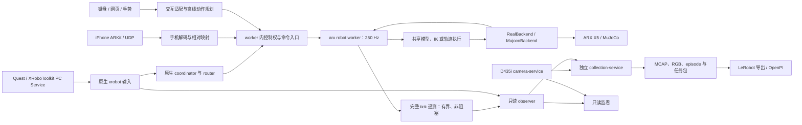

**QuestArmTeleop：采用 arx-televr 的多输入控制架构与迁移方案**

> 实施更新（2026-09-29）：本文保留最初的设计推导和扩展目录，并非当前完成清单。插件框架、手机、多源控制权、MoveJ/MoveL、arx 标定适配和 schema 2 LeRobot 导出已实现；实际用法和验收范围以 [插件工作台](../guides/plugin-workbench.md) 与 [实施记录](arx-runtime-implementation.md) 为准。


日期：2026-09-29。状态：分阶段实施中。已落地 arx 基线、只读遥测、采集与数据存储边界和本机 SDK 构建。实际可用命令、验证结果及待迁移项目见 [实施记录](arx-runtime-implementation.md)。下文保留完整目标架构，不能将计划中的手机、动作或训练导出能力视为已完成。

依据当前工作区源码审阅：QuestArmTeleop HEAD 为 `20dfb08e73495bad58d20b997c53fc99c03dca40`，arx-televr HEAD 为 `cd557afbb9ec280df2d9e12e1582219b85ee1a53`。Quest 工作区已有本地修改，HEAD 不能完整代表审阅内容；实施前需记录实际源文件哈希。本文描述目标目录、命令、协议和验收标准；实际完成范围以实施记录为准。

**采用 arx-televr 作为唯一的机器人控制内核，支持多个输入来源。** Quest 路径从 XR 输入、按键模式、相对位姿映射、IK、关节目标生成，到真机 SDK 和 MuJoCo，完整采用 arx 基线。手机、键盘/网页点动、手势和自动动作通过明确的输入或运动适配接入同一个 worker。QuestArmTeleop 转为围绕该内核运行的工作台，负责连接准备、交互、相机、采集、监看、标定和数据处理。

**QuestArmTeleop 是统一交付仓库。** 所有纳入产品的控制代码、手机 App、协议、标定、算法、模型资源、构建脚本和依赖声明都集中到 `/home/r2/work/projects/embodied/QuestArmTeleop`。其他四个工程保留为来源参考；迁移后的构建和运行不依赖它们的工作区。现有自动手眼标定属于必须保留并迁移的能力，具体边界见下文。

**实施顺序以直接复用为首要约束。** 第一份可运行版本保留 arx 的原文件组织、入口、原生组件、依赖和控制行为。先跑通其独立仿真与 Quest 链路，再装配工作台。后文的多输入命令、运动服务和统一目录是扩展目标，不能成为运行这份基线的前置条件。

- 优先使用上游已有实现和配置；其次在外围增加适配；只有明确需求无法由这两种方式满足时，才做局部源码修改。
- 首轮直接保留 coordinator/router、相对映射、IK、关节目标策略、机器人循环、SDK 提交和 MuJoCo。控制公式、增益及限幅不因目录整理或接口统一而更换。
- 采集遥测、viewer 生命周期和本机夹爪修复分别登记为局部适配；每项记录具体问题、修改文件、行为差异及验证结果，便于与上游比较和更新。
- 手机、点动和动作规划在 Quest 基线交付后逐项加入。新增通用接口只覆盖当前接入所需能力；暂不需要的 JointTrajectory、常驻交接和实验算法保持提案状态。

三个参考项目的取舍、手机坐标与协议适配、控制权切换和动作 API 详见 [多输入与运动功能接入方案](../architecture/control-inputs-and-motion.md)。其中“worker 常驻、控制源显式切换”是后续多输入阶段的目标；首轮只启用 Quest，沿用 arx 原生命周期。涉及 SDK 停止锁存、故障恢复或模型变更时仍需单独处理。

按功能部件解耦的依赖方向、状态所有权、独立验证方式，以及配置/相机/推理的补充审查见 [组件边界与独立优化方案](../architecture/component-boundaries.md)。功能模块不等于独立进程；先整体保留 arx 控制单元，外围按首次使用逐步抽出接口。

Quest 遥操路径直接使用 arx 的 coordinator、router、`JointTargetController` 和 `RealBackend`，不再串联旧 `X5TeleopController → ArmClient → arm-service → OnlineMotion`。手机沿用自己的协议和相对映射，输出 base/TCP 目标交给同一关节控制器，不伪装成 Quest 再映射一次。旧控制层在迁移期间只作为独立回退入口，切换完成后退出生产路径。

这次重构的目标是明确职责并减少控制耦合；不能预先承诺降低多少真机延迟。250 Hz 是机器人循环的目标频率，头显的唯一新帧频率必须独立统计。

**扩展后的目标进程结构如下。** 首轮 Quest 直接使用 arx 原有命令入口；图中的多源控制权入口和运动规划在阶段五接入。控制程序只接收控制所需的数据；相机、录像和页面通过独立进程消费状态。



supervisor 管理控制进程组的启动和退出；camera、collection、observer、viewer 有各自生命周期。图中的 observer 是遥测消费者，不参与 IK、目标限幅或 SDK 提交。

**每项职责只保留一个所有者。** 边界按数据和资源划分，不再依靠控制器继承关系组织采集功能。

| 组件 | 拥有的职责 | 与其他组件的边界 |
| --- | --- | --- |
| xrobot 原生输入 | 唯一 XR SDK 连接、左右手输入校验、坐标基变换 | collection 和 viewer 订阅输入，不再各自创建 XrClient |
| coordinator / router | 模式、Grip 对齐、相对跟随、Trigger、输入超时 | 采集业务不改写机器人模式 |
| 手机/手势/手动输入适配 | 设备协议、输入有效性、坐标和操作语义 | 仅产生类型明确的意图，不创建 SDK，不重复 VR 的相对映射 |
| worker 内控制权入口 | 当前 owner、epoch、有效期、命令类型与能力检查 | 多源可连接和预览；同一时刻只有一个源提交动作 |
| motion 规划服务 | 点动、MoveJ/MoveL/MoveC、预览、离线时间参数化 | 只交付已审查的轨迹；实际执行仍归 worker |
| robot worker | 控制调度、反馈检查、后端生命周期、命令提交、tick 序号 | 唯一真机 SDK 所有者；不等待相机、磁盘、网页或采集 ACK |
| shared model / controller | FK、IK、关节目标、Home、模型一致性 | real/sim 共用；不复制到 collection |
| operations / 功能工作流 | 通用计划、执行、取消；标定/策略等各自编排 | 公共动作接口不拥有相机、采集和模型预测；各功能保留自己的流程状态 |
| observer | 消费完整 tick、原始输入和诊断，提供独立数据流 | 不产生运动命令；序列缺口不能隐瞒 |
| camera-service | 唯一 RealSense 设备连接、原始帧及时间戳 | 复用现有实现，不改变 RGB 语义 |
| observation alignment | 选择具有明确时间/身份的图像与状态 | 不取得设备所有权；训练、标定和策略分别声明选帧规则 |
| collection-service | 任务、episode、录制状态、视频、数据完整性 | 录制开始/结束不隐式移动机械臂 |
| episode I/O | 原始数据格式、版本读写、完整性与封存 | 不依赖遥操、SDK、页面或 LeRobot；采集与离线工具共同复用 |
| viewer | 当前状态、RGB、历史回放、连接状态 | 不直接调用 SDK；关闭页面不关闭控制 |
| dataset tools | 校验、打包、导出、训练输入与统计 | 读取封存数据；不加载真实控制后端 |
| policy adapter / model backend | 观测预处理、统计、模型推理、动作解码 | 模型只产出带语义与有效期的动作；在线执行经 operations 和 worker |

**源码与环境使用两个边界清晰的单元。** 将 arx 的源码及资源按固定提交导入本仓库 `control/`，保留原文件组织、许可证、原生源码归档、二进制哈希和依赖锁。`UPSTREAM.toml` 记录来源、导入提交和本地适配清单。日常运行不依赖旁边的 `/home/r2/work/projects/embodied/arx-televr` 绝对路径，不修改那份参考工程。

集中交付的具体规则：

- arx 完整控制单元导入 `control/`；选用的手机 App 与协议、运动算法按下列边界导入，记录原文件、提交、实际内容哈希、许可证和本地修改。
- 不通过指向兄弟仓库的软链接、`PYTHONPATH`、editable 安装、`uv` path 依赖或子进程工作目录拼接系统。源码依赖固定后放在仓库内；可安装第三方库使用锁文件管理。
- `dependencies.lock.toml` 继续作为仓库依赖清单，并关联 `control/UPSTREAM.toml` 及各功能的来源记录。SDK 补丁、原生构建及模型生成过程可从本仓库重建。
- Python 3.10 控制环境、Python 3.12 工作台和推理环境仍分别管理，都由本仓库的声明与脚本配置。代码集中不要求合并互不兼容的数值库环境。
- 系统驱动、Quest PC Service、Xcode 等平台依赖记录安装版本和步骤；本机输出、数据和权重通过配置定位。文档来源链接与历史元数据路径不参与运行路径解析。

以下目录表示逐步形成的边界。初次导入保持 arx 原目录和启动方式可用；`adapters/`、`motion/` 及工作台新目录随具体功能建立，避免为了匹配目录图先重写上游代码。

```text
control/                        arx 控制单元，Python 3.10，独立 uv.lock/.venv
  arx5_vr/                      保留上游模块组织
  config/                       robot / vr / tool，以及机器 profile
  models/                       由统一源模型生成
  native/                       原生二进制、源码归档、许可证和校验值
  adapters/                     observer、命令接入、本机 SDK 适配
  motion/                       独立运动原语与轨迹执行接口
  UPSTREAM.toml
src/
  runtime_client/               版本化协议读取；不导入控制 SDK
  inputs/                       手机协议、手势和交互适配，不含 SDK
  operations/                   公共动作预览/执行/取消、示教点；不集中所有功能状态机
  observations/                 有时间与身份的图像/反馈对齐
  collection/                   任务、episode、MCAP、视频
  episode_io/                   原始数据读写、版本与完整性
  sensors/                      相机及只读电机诊断
  monitoring/                   页面、当前状态、历史回放
  handeye_calibration/           保留现有采样、自动计划、求解与验证包
  datasets/                     校验、任务打包、LeRobot 导出
  policies/                     观测/动作适配及推理会话，模型后端保留独立环境
  workstation/                  连接准备、启动器、进程状态
apps/ios/                      导入选用的 Swift App 与 Xcode 工程
contracts/                     跨环境协议规范、schema 与共同金样本，按需增加
third_party/                   固定的源码依赖、SDK 来源及许可证
scripts/setup/                 本仓库环境、SDK 和原生资源的安装/构建
dependencies.lock.toml         固定来源清单，关联控制单元及功能来源记录
configs/workstation.toml        相机、存储、端口与界面配置
tests/                         按控制、协议、采集、工具分组
```

首轮保留工作台 Python 3.12 / NumPy 2.x；控制单元保留 arx 的 Python 3.10 / NumPy 1.26 和 iceoryx2 0.9.1。两个解释器通过进程协议通信，不互相导入源码和扩展模块。LeRobot / 推理仍使用现有专用环境。目录整理放在模块脱钩之后，避免先批量搬文件。

observer 在控制环境运行，以 iceoryx2 消费数据，再通过本机 Unix socket 向 Python 3.12 工作台提供带长度边界的版本化消息。JSON 编码和慢消费者处理均在 observer 中，避免进入机器人循环；后续只有实测吞吐不足才引入更复杂的编码。

手机的 Python 解码器使用 Python 3.12 的类型别名语法，放在工作台环境，通过独立命令通道连接控制环境。控制命令、可靠操作事件、逐周期录制和 latest-only 监看各用自己的队列规则。没有进程隔离需要的功能可以共用进程，不为每个按钮建立服务。

**Quest 输入首先验证同一原生链路。** 原生驱动加载 `PXREAInit/PXREADeinit`，解析 `Controller.left/right`、`timeStampNs`、`primaryButton/secondaryButton` 等字段，与当前 Quest Pybind 使用的 API 和数据结构相符。原生源码支持左右手，arx 当前配置只启用了右手；采集需要在配置中额外开启左手通道。

这些是源码兼容依据，不是设备兼容验收。第一阶段使用真实 Quest 输入配合 MuJoCo，验证左右手、按键、追踪失效、休眠/恢复、重新居中及 USB 连接，不构造真机后端。现有 USB 准备、唤醒和发现控制作为设备工具保留；涉及自定义 discovery 模块的功能需验证能否在不重复初始化 XR SDK 的情况下使用。

驱动标称 250 Hz 不代表头显产生 250 个新帧。原生驱动按唯一 SDK 帧发布，监看分别显示 XR 唯一帧率、路由命令率、机器人循环率和反馈年龄。

**遥操行为以 arx 基线为准，采集按键独立。** 以下是建议交互，属于本方案的新默认行为；左手采集功能尚未接入 arx 交付代码。

| 操作 | 建议行为 | 归属 |
| --- | --- | --- |
| 右 A 按住至少 150 ms 后释放 | 沿用 arx 模式切换及 Disabled 等待规则 | coordinator |
| 右 Grip | 沿用参考捕获、相对跟随及松握重对齐 | router |
| 右 Trigger | 沿用独立夹爪宽度控制 | router |
| 右 A+B | 沿用 arx 的 Disabled/Home 行为 | coordinator + worker |
| 左 X | 开始录制；录制中再按则结束并保存本条 | collection 输入适配器 |
| 左 Y | 作废当前录制；没有录制时无动作 | collection 输入适配器 |
| 左 X+Y | 抑制单键动作 | collection 输入适配器 |
| 任务开始、暂停、结束、作废上一条 | 工作台 CLI/TUI 明确操作 | collection |
| 预抓取、真机回放、自动标定、策略执行 | 后续独立操作模式，不复用上述采集按键 | worker 的独占输入适配 |

采集适配器以输入序号和按键边沿去重，输入失效或重连时先等待松键；不重放断线前的按钮事件。即使原生源码含有 episode coordinator 功能，当前 arx 配置将其连接到 unused topic，首版不再同时启用第二套采集状态机。

完整采用 arx 时，以下差异必须在配置、操作说明和元数据中写明：真机启动会回 Home；`Disabled` 会运动到 Home，不能翻译成“电机关闭”或“急停”；FreeDrive、位置保持和退出阻尼是不同状态。终端停止沿用 `request_stop()` 和 SDK 退出语义，不通过发送 Disabled 代替停止。追踪过期、路由故障与进程退出逐项按基线验证，不把它们概括成同一种停止效果。

**采集协议需要新增完整 tick，现有 IPC 不够。** 当前 `RobotBridge` 发布 q、dq、TCP、夹爪和模式，缺少完整命令、增益、IK 状态、运行身份和可检测丢样的统一序号。不能用 viewer 的最新状态轮询替代逐周期录制，也不把 `tuning.jsonl` 的文件尾随读取作为正式采集接口。

建议新增 `RobotTickV1` 固定布局消息，独立于现有原生控制 topic；worker 在 tick 内复制快照，使用有界、非阻塞路径发布。不得延长现有 loan 或让消费者持有 SDK/MuJoCo 的可变数组。

| 数据组 | 必须携带的信息 |
| --- | --- |
| 身份 | protocol_version、runtime_id、boot_id、robot_id、tick_sequence、active_source、source_session、owner_epoch、模型和控制 profile 身份 |
| 时间 | tick 开始、反馈采样/新鲜度依据、命令实际提交、tick 完成的 host monotonic ns；SDK 时间另存 |
| 测量 | q、dq、指尖 pose、夹爪宽度、反馈模式/故障；缺失字段带有效性标记 |
| 输入/目标 | 有无新末端目标、目标 pose、完整 IK joint_goal、IK 残差/收敛状态、控制来源、mapping_profile、motion_id 与请求类型 |
| 下发命令 | sent_q、sent_dq、夹爪目标、附加前馈、实际使用 kp/kd、提交成功与否、命令序号 |
| SDK 输出 | 可获得的 SDK 命令读回、重力项及其时间/来源，与应用提交值分开 |
| 运行状态 | 阶段、错误、累计发布失败/丢样、终止状态 |

消息包含固定数组和有效性位；变长错误文本、模型文件和参数快照通过启动描述/事件通道传输。`tick_sequence` 持续递增；故障和终止也有可确认的边界。固定布局、字段偏移和 ABI 版本由 reader/writer 共同校验。

现有 arx 的顺序是先读反馈，再算目标和下发。因此同一 tick 的“反馈时间”通常早于“命令提交时间”。两者必须保留各自真实时间，不能为兼容旧导出器把新命令时间改早，也不能把 observer 收包时间冒充采样时间。

observer 为监看提供 latest-only 状态，为 collection 提供保序、带序号的完整流。每个消费者使用独立有界缓冲；慢消费者不能阻塞机器人。建议初始缓冲 4096 ticks（250 Hz 下约 16.4 秒），实际内存与性能在阶段二验证。队列溢出、桥接断线、采集进程重启或源序号缺口使当前 episode 标记为不完整，不能静默保存为成功。

启动时先建立订阅与运行身份握手，再允许录制。开始/结束录制明确记录起止序号；正常结束需收到结束边界之前的所有消息。生产者消失且没有终止记录时，不把未闭合区间判断为完整。observer 丢失后可重新连接同一仍存活 runtime，但不得拼接出一条跨缺口的完整 episode。

**训练数据使用显式的新 schema，旧数据继续可读。** 保留 MCAP + RGB 视频 + episode 元数据 + 任务 ZIP 的产品形态。现有 schema 1 原样读取；新记录采用 schema 2，增加分离的 `/robot/command` 和原始输入信息，所有消费者按版本分派。

建议默认训练 action 定义为实际成功提交给 SDK 的六关节位置和夹爪目标，即 `sent_joint_position + sent_gripper_width`。这与旧项目的 `requested_pos` 不保证同义，不能只改字段名后混用。原始记录同时保存末端目标、IK 完整目标、单步限制后的下发目标和 SDK 读回，未来可显式选择其他 action 定义。

30 FPS 图像作为训练观测锚点，独立选择不晚于图像主机时间的最新有效反馈和最新成功下发命令，并检查两者年龄。机器人的完整 250 Hz 状态和命令另存高频 sidecar。无法组成有效且因果正确的样本就排除训练锚点，原始档案保留；不通过插值或未来反馈伪造缺失命令。

新元数据包含 action_definition、控制提交、模型/tool 哈希、TCP frame、SDK 补丁身份、增益、控制周期、输入来源和时间语义。FreeDrive 没有有效的位置跟随 action，Home/预抓取/回放不是普通遥操示教，按 source/phase 明确标记并由默认训练导出筛除。新旧 schema 或不同 action 定义不能自动合并训练，必须显式转换并记录转换规则。

**保留已验证的本机修复，并将它们限制在硬件边界。** 完整采用 arx 架构不意味着丢掉已确认的硬件问题处理。

| 现状 | 建议处理 |
| --- | --- |
| Quest 夹爪上电跨圈修复 | 迁移 `gripper_turns.h` 和固定 SDK 补丁到 Python 3.10 控制环境重新构建；不复制 Python 3.12 的扩展模块。保留唯一圈数选择、反馈/命令对称换算和失败拒绝行为 |
| 夹爪接触限力保持 | 先维持 arx 的基线模式；后续作为 RealBackend 的明确夹爪策略接入，记录状态及力矩。未接入前不宣称完整替代旧采集抓取行为 |
| 温度/故障/部分电流采集 | 独立只读 SocketCAN 诊断进程；保留原始来源、时间、缺失值和事件序号，独立于控制 tick 接入 MCAP |
| 两项目的设备锁路径不同 | 迁移期间为本仓库旧、新入口使用同一按 CAN 接口标识的合作锁，运行全程持有；此锁不能约束未采用同一规则的外部工程 |
| Quest 使用腕部 link6；arx 使用指尖 TCP | 工作台统一显示 arx 的生成模型和 tcp_link。旧标定/旧回放保留原模型身份；未经 frame 变换和几何确认不能重用 |
| link6 有效质量 0.481 kg 与 0.570 kg 不同 | 首先保存为两个具名 profile。仿真基线用 arx 原参数；目标设备的负载、TCP 和重力平衡验收后确定现场 profile，不混搭两套模型 |
| 旧项目桌面路径限制、Ruckig | 不串入 arx 普通遥操路径；在模式能力表中标记差异。若后续要求桌面限制，单独设计控制内核检查并验证，未实现时界面不得显示“已保护” |

夹爪补丁的可移植构建与回归是本机真机切换前的必要工作，不用“每次先闭合上电”替代该修复。硬件 profile 除路径、TCP、负载外，明确记录增益、关节限制、夹爪映射和 Home。

**生命周期把控制故障与外围故障分别处理。** 当前 arx `app.py` 会因 viewer 正常退出而结束整组进程，需要调整这个装配行为；这属于运行管理适配，不改变 IK 或跟随公式。

| 故障/操作 | 目标行为 |
| --- | --- |
| 关闭 viewer | 控制、相机和采集继续运行 |
| observer / collection 异常、磁盘满或录像失败 | 本条记录失败并保留原因；不由这些进程直接切换机械臂模式 |
| XR 过期或掉线 | 使用 arx 原生超时状态机；记录实际模式转换，并在仿真与现场分别验收 |
| 活动控制来源必需的 input / router / coordinator 异常退出 | 控制 supervisor 检测并让 worker 执行 arx 停止清理；不自动重新启用控制。多源阶段未活动来源的故障按其自身生命周期处理 |
| worker 反馈异常或正常收到停止 | 沿用 request_stop / SDK 清理；向采集发出终止边界，能正常结束的部分排空保存 |
| worker 被 SIGKILL 或整机断电 | 不承诺 Python 清理可执行；episode 标记中断，恢复时不得自动继续动作 |
| supervisor 收到停止 | 按受控顺序停止输入/路由，再退出 worker；给 SDK 清理留出时间 |
| 重新启动控制 | 新 runtime_id、新序号空间、新参数描述；旧 episode 不跨运行拼接 |

启动/停止只针对本次运行的进程组，不使用 Rollio 全局关闭广播。原生程序仍监听全局关闭总线的现有限制要保留在运行诊断中，不能因为 prefix 唯一就声称完全隔离。

**点动、自动标定、回放和策略执行通过类型明确的命令接入同一个 worker。** 它们需要关节目标或轨迹，而 arx 当前 `ControlCommand` 主要接收末端目标；新增独立 JointTarget/JointTrajectory 契约，不把关节数组藏进 pose 字段。

本节在阶段五按功能实施。阶段零至四仅使用原 Quest 控制入口，不先增加通用命令执行器；遥测中的来源身份可固定为 Quest，数据协议不要求控制链路先实现多源仲裁。

迁移初期保留标定的离线计划、求解、验证和旧入口；手动采样及自动运动均待新的设备适配完成后接入 arx。旧标定/真机回放可在本仓库旧入口中单独使用，不能与新运行同时拥有设备。最终以 source（quest/phone/web/cli/hand/policy）和 operation（teleop/jog/trajectory/teach/calibration/replay）分别表达输入来源和工作模式。同一时刻只允许一个来源拥有运动控制权；非 owner 的输入和原生模式请求均不得到达执行后端。

命令带 source、owner_epoch、sequence、接收端有效期和 model identity，并验证有限值、维度和设备限制。预设动作可独立使用轨迹规划器；VR 模式保留 arx 原始关节目标逻辑。切换来源要先撤销旧 owner、处理当前运动、确认反馈、清理旧目标并重新捕获参考，再显式授予新 owner。正常切换保持 SDK 和 worker 生命周期，不隐式回 Home；这需要新增并验收 arx 入口的模式交接适配。SDK 停止锁存后的故障恢复不可用普通来源切换绕过。

**自动手眼标定已有实现，迁移时保留完整流程。** 当前 `src/embodied/calibration/wrist/` 提供 D435i 眼在手上标定，入口已注册到 `./run.sh handeye`。它与 Quest 方向对齐、夹爪上电跨圈修复、负载质量/质心辨识是不同功能。

| 现有文件 | 已有能力 | 迁移处理 |
| --- | --- | --- |
| `cli.py` | marker/manual/plan/auto/solve；auto 默认离线检查，显式 `--actuate` 才采样运动 | 保留命令和离线入口；替换设备装配 |
| `motion.py` | 默认 20 个拟合姿态与 6 个独立验证姿态；计划校验、逐点执行、结束/异常清理 | 保留计划及编排，运动执行改接统一 worker |
| `arm.py` | `CalibrationArm` 通过 ArmClient 获取控制权、读反馈、位置保持、命令和阻尼 | 替换旧服务适配；标定不创建第二个 SDK owner |
| `session.py` | 静止多帧采样、运动/重复姿态拒绝、原始 PNG、角点、PnP 与机器人快照存档 | 保留会话记录与质量检查；适配新反馈和相机时间契约 |
| `target.py` | ArUco 单标记、RGB 内参与畸变处理、平面姿态歧义拒绝 | 保留检测与实际流内参语义 |
| `solver.py` | 相对运动 SVD、可用时的 OpenCV 方法、离群点处理、留一法稳定性、独立验证 | 保留求解及 candidate/validated 结果，不自动启用外参 |

现有计划和运动使用 `robot_control/trajectory.py` 的五次关节轨迹及 `robot_control/motion.py` 的到位检查。默认轨迹采样率 50 Hz、速度 0.15 rad/s、加速度 0.3 rad/s²；这些是标定计划参数，不是 arx 控制循环的新频率。迁移时保留轨迹时长与限制，由 worker 在自己的周期执行已预览的计划，工作台只负责发起、等待到位和采样；不能把旧 50 Hz 睡眠下发循环叠加到 arx 的 250 Hz 循环上。

需要显式完成四项适配：

1. **运动与退出。** 自动流程获取 `operation=calibration` 的独占控制权，检查当前位置接近计划中心、输入和反馈有效，再建立位置保持；保留当前夹爪开度。现实现要求中心误差不超过 0.03 rad，逐点静止后才采图。正常结束和异常时原流程请求阻尼、不回零；arx 的 FreeDrive、停止清理和 Disabled/Home 语义不同，需实现并验证明确的标定退出行为，不能简单替换枚举。未支持时报告能力不可用。
2. **图像与反馈。** 当前 CLI 通过相机插件创建采样源；已核对 `configs/plugins.toml`，默认 realsense 插件实际指向 SharedCamera，已经复用唯一 camera-service。保留这条路径，补齐原始 RGB、实际内参、流身份及时间契约。保留静止后的新帧筛选、不同帧的标识和采图前后反馈证据；不能用两次读取同一个缓存状态冒充采样前后反馈，不能把接收时间称为曝光时间。相机、反馈缺失或过期时拒绝该次采样并终止后续自动运动。
3. **模型与坐标。** 当前 CLI 默认 `link6`，相机为 RGB 光学系，求解约定为 `T_base_eef @ T_eef_camera @ T_camera_target = T_base_target`。迁移后从 arx 统一生成模型取得关节顺序、FK 和 frame 身份；手眼外参仍可定义在 `link6`，只需显式关联到当前 TCP，不能直接把旧 `link6` 结果改名成 `tcp_link`。旧会话由匹配的历史模型离线读取；新模型需要新计划和验证。
4. **计划与结果。** 预览/执行绑定同一轨迹、起点、模型/tool/profile 与 owner；旧 waypoint JSON 不等于已经冻结的执行轨迹。手眼 `session.json/result.json` 的 schema 与训练 episode schema 分开版本化，保留旧读者、原始采样和独立验证集。`validated` 只代表通过数值门槛，采用外参仍是明确操作。

标定的 EEF 工作区约束、关节余量、到位/静止检查及失效清理必须继续存在；arx 原模型关闭碰撞，已有 EEF 边界也不是全连杆碰撞检测。不能因更换后端删除这些约束，或把采集失败后继续运动当作成功。

原自动采样代码和相关测试已存在，当前说明仍标注未完成真机自动运动验收。方案审查时仅阅读实现；后续实施已重跑旧项目离线测试，仍未运行真实硬件。迁移验收应覆盖现有求解/噪声/离群点/退化/独立验证、计划模型不匹配、离线入口不加载驱动、静止采样以及中断清理，再补新相机/反馈协议和 arx 仿真执行。自动标定在阶段五作为现有能力恢复，完成迁移验收前保留旧入口，不将它降为可选实验。

**分阶段迁移，每个阶段都有独立完成条件。** 先交付 arx 原基线与 Quest 仿真，再补独立监看、采集和本机真机适配。手机与基础手动控制在这个基线上增量接入。多输入框架、手势和实验功能不阻塞基本遥操交付。

| 阶段 | 实施内容 | 完成条件 |
| --- | --- | --- |
| 0：直接复用基线 | 建立隔离开发分支/工作树；登记现有本地修改；按原组织导入 control/ 固定来源；建立独立环境；保留原启动入口和旧项目入口 | 原项目未被覆盖；导入版可独立运行；arx 离线检查和原生 demo/MuJoCo 通路通过；记录 baseline 报告 |
| 1：Quest 接入 | 首先使用原 coordinator/router/worker 跑通 Quest；再增加左右手配置、USB/唤醒工具、viewer 生命周期和 supervisor 的必要装配 | 真实 Quest 驱动仿真；与原版的模式、Grip、Trigger、断流/恢复行为一致；独立监看退出不影响控制；此阶段不构造真机后端 |
| 2：只读数据边界 | RobotTickV1、observer、runtime_client；保留原 Quest 命令入口，不加入多源执行逻辑 | 遥测可追溯到原控制循环；慢消费者不阻塞控制；适配前后控制等价性与周期性能通过 |
| 3：完整采集 | 抽出 collection-service；接入相机、左手按键、MCAP schema 2、任务打包、回放、LeRobot 导出 | 合成状态/视频可端到端导出；旧 schema 1 仍可读；新 action 与时间语义测试通过；异常条目不能伪装成功 |
| 4：本机真机 | SDK 跨圈修复、共同设备锁、只读诊断、现场模型 profile；先仿真/假硬件回归，再现场验收 | 现场输入、夹爪开度、Home、FreeDrive、跟随、停止、掉线行为通过；完成真实示教及导出；记录尚未迁移的能力 |
| 5：输入与动作扩展 | 接入控制权检查、手机、基础点动与 Ghost；恢复手动/自动手眼标定所需的运动与相机接口；再补夹爪限力保持、示教点、MoveJ/MoveL、预览执行、预抓取、真机回放和现有在线推理适配；每项从仿真开始 | Quest 基线持续通过；多源只允许单 owner；切换无旧命令重放和隐式 Home；手机方向/协议/断流正确；手眼采样、计划、求解、独立验证及中断处理通过迁移验收；其余能力逐项核对后切换默认入口，归档回退版本 |
| 6：可选扩展 | 浏览器手势、MoveC/混合路径、负载辨识、拖动后保持和备选 CLIK 评估 | 每项有独立 profile、能力标记与验收；实验功能失败不影响已交付 Quest/手机链路 |

阶段四可以交付独立的 arx 遥操采集入口，但在旧功能未补齐时，不宣称整个项目已无损替换。手眼标定迁移未完成时，保留可单独运行的旧入口，不提前退役其 arm-service。推理和其他暂不使用的自动动作可以明确标为未启用；不能悄悄让旧代码连接已退役的服务。

建议新增命令如下，按阶段提供，手机与 select-source 属于阶段五。命名在实施时统一纳入现有启动器；启动器调用导入版 arx 的入口，保留它独立运行和诊断的能力，不再为每个功能添加根目录脚本：

```text
./run.sh control start --backend sim --input quest
./run.sh control start --backend real --input quest
./run.sh control start --backend sim --input phone
./run.sh control select-source phone
./run.sh control console
./run.sh control status
./run.sh control stop
./run.sh camera-service
./run.sh collect --task "任务描述"
./run.sh monitor
./run.sh dataset export <任务目录>
```

`real` 入口应清楚显示所选模型、夹爪补丁、Home 和启动行为。迁移期间通过显式旧入口回退，禁止自动由新控制失败转为旧控制。回退先停止当前运行并释放设备锁，再启动旧版本；新采集数据不反向降级覆写。

**验收关注行为与数据正确性，再比较性能。** 下面是拟定的验证范围，不代表已测试通过。

- 控制等价性：同一合成输入分别驱动原始 arx 和集成版本，比较模式序列、有效末端命令、IK/关节目标、夹爪目标及退出行为；非控制功能开关不应改变控制公式和参数。
- 复用范围：固定来源与本地补丁逐文件可审阅；每个控制链路差异都有具体功能依据。导入版可脱离工作台独立运行；关闭多输入扩展后，原 Quest 基线仍可单独验收。
- 仓库自包含：在看不到四个兄弟工作区的独立 checkout 中，按锁文件及声明的平台依赖完成构建、离线检查和仿真。检查软链接、环境路径、源码导入、构建脚本及子进程工作目录；所用代码与资源均来自 QuestArmTeleop 或声明的安装依赖。iOS 工程在对应 Mac 环境单独验证，不要求 Linux 构建 App。
- Quest 兼容性：真实头显接仿真，检查两手输入、唯一帧序号、追踪丢失、休眠、重新居中与 USB 恢复；不能只用 `.so` 文件存在作为通过条件。
- 多源控制：同时连接 Quest、手机和网页，验证单 owner、epoch 撤销、过期/乱序命令、切换参考、Preview 不驱动，以及手机重连、后台恢复和本地/远端复位握手。
- 运动功能：预览与执行使用同一计划；起点、工具、模型、限位或 owner 变化使旧计划失效；持续点动松键即失效，不能补发积压动作。
- 自动手眼标定：保留离线默认行为和显式执行入口；计划及坐标身份一致，未静止/旧帧/反馈过期不能采样，丢标记和中断后不继续运动；结束不隐式 Home，拟合与验证分离，结果不自动应用。
- 部件解耦：依赖方向、独立启动和部件 fixture 按组件方案验收；离线导出/标定/监看不加载运动设备，模型预测不直接提交 SDK，启动脚本不再成为其他功能的参数数据库。
- 时序正确性：验证反馈先于本 tick 新命令的实际关系；图像锚点不能引用未来命令；SDK 时间和 host monotonic 时间分别保留。
- 数据完整性：暂停/保存/作废、录制进程重启、磁盘满、相机中断、桥接断线、队列满、最后一批数据丢失和 producer 退出均有确定结果。
- 兼容性：至少一套旧 schema 1 fixture 和一套新 schema 2 fixture，均可校验、网页回放、打包并导出；跨模型标定和真机回放被正确拒绝。
- 性能：同机重复比较原始 arx、加入 observer、再加入相机/录像三种组合，每次至少五分钟。记录新帧率、命令率、tick 计算及间隔 p50/p95/p99/max、missed deadlines、遥测队列和丢样。以原有 245–255 Hz 平均频率检查作为最低条件，并要求正常采集零丢样；任何稳定出现的周期尾延迟恶化均需分析，不能只展示平均 250 Hz。
- 真机响应：统一 TCP、模型、增益和控制限制后，再测输入变化到命令提交、反馈开始变化的分段延迟。仿真频率不能替代实物跟随、停止和夹爪效果验收。

**现有文件的迁移去向可以明确落实。** 以替换控制依赖为主，不做无差别重写。

| 当前文件/目录 | 处理 |
| --- | --- |
| `quest_teleop/base_controller.py`、`controller.py`、旧 XRoboToolkit 控制器继承 | 在新运行中移除；由 arx 输入/路由/worker 完整替代 |
| `robot_control/service.py`、`client.py`、`hardware.py` | 普通遥操退出使用；硬件修复和诊断单独提取，不保留第二个 SDK owner |
| `robot_control/online_motion.py` | 不进入 arx VR 跟随；自动动作如有需要复用其规划能力 |
| `quest_teleop/presets.py`、`collection.py` | 拆分运动与采集职责；采集状态迁到 collection，运动进入独占模式 |
| `quest_teleop/runtime/session.py` | 改为独立 collection-service，移除控制器回调及 ArmClient 拉取依赖 |
| `recording.py`、`mcap_io.py`、`video.py`、`task_package.py`、`export_lerobot.py` | 保留主要实现，增加 schema 分派与新的命令流/动作定义 |
| `robot_core/camera_service.py`、`camera_client.py` | 保留并逐步搬入 sensors，维持单设备所有权 |
| `robot_control/motor_feedback.py`、`gripper_turns.h` | 分别成为只读诊断组件和 SDK 本机补丁 |
| `robot_simulation/scene.py`、`web/` | 改订阅数据来源，保留 UI；生成模型经统一资产适配供网页读取 |
| `handeye_calibration/` | 保留现有包和 marker/manual/plan/auto/solve 全流程；阶段五替换 CalibrationArm 与相机装配，迁移计划执行、静止采样及退出行为 |
| `quest_teleop/frame_calibration.py` | 保留方向测量算法与历史配置读取；新链路需要方向对齐时适配原生输入与配置，避免重复执行坐标变换 |
| `src/embodied/policy/pi05_sft/`、`integrations/openpi/` | 保留现有本地工作；先审查设备执行依赖，阶段五迁移在线执行端，训练环境不并入 control |
| `src/embodied/policy/pi05_zeroshot/` 及其与微调推理的交叉导入 | 实验入口保留；共享观测、策略动作和操作能力逐项迁入正式模块，不再以实验目录作为生产依赖 |
| `robot_core/collection_motion.py`、`camera_control.py` | 分别移除反向解析启动脚本、查询遥操内部会话的最终依赖；由明确配置和通用相机使用租约替代，旧兼容保留到迁移完成 |

完成后，控制单元应能在没有 camera、collection、viewer、LeRobot 的环境中独立运行；工作台应能只打开历史数据而不加载 XR/CAN SDK。两边以明确的数据契约和显式操作模式协作。

**源码依据与当前验证范围。** 上述决策主要来自以下实现：

- arx `arx5_vr/app.py`、`runtime.py`：进程装配、viewer 退出联动、子进程停止。
- arx `native_config.py`、`ipc/`、`worker.py`：右手通道、未启用的采集 topic、模式/状态总线与控制循环。
- arx `real.py`、`model.py`、`sim.py`、`recording.py`：直接 SDK 提交、反馈/命令顺序、模式/IK、物理仿真与调试日志。
- arx `native/rollio-source.tar.gz` 内 `robots/xrobot/README.md`、`src/bin/device.rs`、`src/config.rs`、`src/frame.rs`：SDK 动态符号、左右手通道、输入字段及时间语义。
- Quest [会话采集](../../src/legacy/quest_teleop/runtime/session.py)、[控制器快照](../../src/legacy/quest_teleop/controller.py)、[MCAP](../../src/embodied/data/episode/mcap_io.py)、[导出](../../src/embodied/data/export/lerobot.py)、[多频率数据](../../src/embodied/data/export/multirate.py)：旧录制耦合和动作/时间语义。
- Quest [夹爪修复](../guides/gripper-startup.md)、[SDK 构建](../../scripts/setup/build_gripper_sdk.py)、[标定机械臂](../../src/embodied/calibration/wrist/arm.py)、[设备锁](../../src/embodied/contracts/device_lease.py)：迁移时需要保留或适配的设备行为。
- Quest 手眼标定：[操作说明](../guides/simulation-calibration.md)、[CLI](../../src/embodied/calibration/wrist/cli.py)、[计划与执行](../../src/embodied/calibration/wrist/motion.py)、[静止采样](../../src/embodied/calibration/wrist/session.py)、[求解](../../src/embodied/calibration/wrist/solver.py)、[既有测试](../../tests/test_calibration.py)。这些是当前实现依据，不表示已迁移到 arx。
- 新增参考仓库的具体实现、已发现的不能照搬之处与分功能优先级，见 [多输入与运动功能接入方案](../architecture/control-inputs-and-motion.md)。
- 进一步的功能边界、隐式依赖、相机注册纠正与独立优化验收，见 [组件边界与独立优化方案](../architecture/component-boundaries.md)。

当前完成源码与归档审阅、模型/tool/原生文件哈希核对、补充参考项目审阅和方案编写。reBotArm 梯形时间剖面另做了不导入硬件的标量验算；没有安装 arx 环境或执行设备/整链路仿真验收。现有源码、配置及用户本地修改保持原状。
