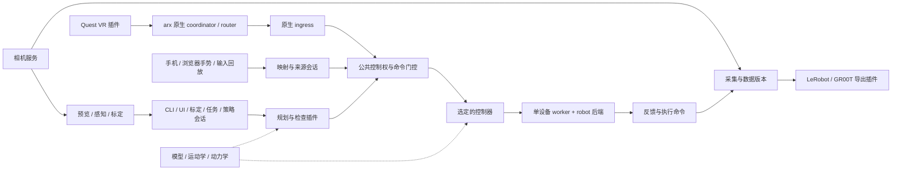

# 三个参考仓库的插件迁入清单

> 执行更新：三个原目录已集中迁入并保存在本仓库的恢复归档中；本表保留迁移前的功能审查。当前代码位置、插件入口、验证和仍需统一到 arx gateway 的操作边界见 [合并后的组件说明](consolidated-components.md)。下文“待迁入/拟定”是原方案状态，不再代表源码交付状态。

日期：2026-09-29。目标仓库：QuestArmTeleop。本文是源码审查和迁移方案，**没有把下列拟新增插件记为已实现**。现有功能与无设备验收见 [实施记录](arx-runtime-implementation.md)，使用入口见 [插件工作台](plugin-workbench.md)。

**最终交付目标：`arx5_test`、`reBotArm_control_py`、`robot-teleop` 三个原目录全部可以退役。QuestArmTeleop 独立承载其保留功能，以插件组织，并包含构建、测试、维护所需的源码、配置、模型资源、工具和说明。原目录移走或不可访问时，迁入功能仍可独立使用；有完整替代的功能用替代实现和验证证据关闭。**

这将“选择性复用”收敛为三个仓库的完整功能整合。41 项是当前功能台账，不是排除未列文件的白名单；逐文件收尾检查发现遗漏时继续补入。目录退役不通过将整套旧应用复制到仓库后继续独立运行来完成，各功能仍遵守本文的插件边界。

## 结论与迁入原则

三个仓库有用的功能都应进入迁入范围。只有证明现有实现覆盖了同样的设备、行为、数据语义和验证要求，才把旧实现标为“已替代”。上一版范围偏窄，遗漏了 B601 硬件支持、双相机标定、视觉任务、GR00T 数据与推理，以及多项诊断和控制算法；这些均纳入本清单。

保留 arx-televr 的完整 Quest 链路作为默认实现，沿用它已有的 VR、协调器、路由、模型、控制器、设备后端分工。其他功能通过相应边界接入；不会为了统一外观先重写原生遥操。

- **功能迁入**：保留算法、工作流、交互、模型资源及相关测试，适配本仓库接口，运行不引用兄弟仓库。
- **局部合并**：已有相同基础能力时，补齐缺失行为和测试；不再启动第二个设备连接、控制循环或控制权状态机。
- **证明后替代**：列出对应实现，完成行为对照。名称相同、都依赖 Pinocchio、都能导出 LeRobot，都不足以证明覆盖。
- **修复后迁入**：实验代码和已知缺陷有明确修复项，可成为实验插件；不会因有缺陷而丢弃整个能力。
- **资源随功能归档**：配置、URDF、网格、模型资产、示例与测试随插件管理。环境目录、构建输出、运行期证书/token/PID、大型数据集和权重采用重建或资产清单管理。

“一切皆插件”按有独立替换价值的部件划分。数据类型、单位、控制权和最终命令检查是公共约束，不需要把每个函数做成可替换插件；也不要求每个插件独占进程。

## 当前实际完成到哪里

| 来源 | 已进入 QuestArmTeleop | 仍未覆盖 |
| --- | --- | --- |
| arx-televr | `control/` 导入的原生链路、真实/仿真后端、模型、SDK、适配层；已按 VR、routing、ingress、controller 等装配 | 下述跨机器人、扩展规划、相机及业务契约还需补齐；当前接口仍以 X5 六轴为基础 |
| robot-teleop | `apps/ios/`；`src/robot_teleop/` 中 ARKit、UDP、协议、基础类型和相对位姿映射；`src/inputs/phone.py` 接入现有运行时。来源清单冻结 61 个文件 | mock/replay、在线 Ruckig、离线运动学、完整诊断和复位握手等，见 C 表 |
| arx5_test | `src/operations/vendor/arx_motion/` 的 profiles、geometry、interpolation、limits、contracts 五个数学模块；基础动作接入 `arx.basic` | 几何模块存在不等于 MoveC/混合路径已经可执行；其余能力见 A 表 |
| reBotArm_control_py | FreeDrive、保持、示教点等思路已用于现有 arx 操作 | 没有直接迁入其驱动、运动学、动力学和控制策略源码，见 B 表 |

本表描述实际迁入范围，不表示三个项目已经完整迁完。当前 arx 自动标定是原 QuestArmTeleop 标定流程的 arx 适配，不是 arx5_test 双相机标定的完整迁入。

下表中的 `planner.*`、`robot.*` 等是拟定插件名/功能边界，未列入当前注册表的仍需实施。现有 `Registry` 能登记工厂，不代表已经具备所有新类型的契约、装配和生命周期。

## A．arx5_test

源码根目录：[arx5_test](../src/arx5_control)。表内路径相对此根目录；阶段编号见后文。

| 编号 | 能力与源码依据 | 迁入决定、插件边界及验收要点 |
| --- | --- | --- |
| A01 | `src/arx5_control/motion/{profiles,geometry,interpolation,limits,contracts}.py`：时间曲线、线/弧几何、插值、约束 | **部分已迁**。共享数学库继续复用；插件消费它而非复制。核对原始测试与本地 Python 3.10 补丁，区分“已导入”与“已接执行入口”。P1 |
| A02 | `motion/{offline,cartesian_time}.py`：离线 Ruckig、笛卡尔进度时间参数化 | **迁入** `planner.ruckig`。现有 smoothstep MoveJ/离散 MoveL 不构成完整替代；保存 q/dq/时间及边界条件，验证限速、加速度、jerk 和重定时。P1 |
| A03 | `motion/{geometry,offline,interpolation}.py` 及控制器中的 MoveC、waypoint、圆角混合 | **迁入** `planner.cartesian_path`。已有几何只是基础；补路径编排与执行。验证圆弧经过点、拼接连续性、工具/工件坐标、同一路径变速后几何不变。P1 |
| A04 | `motion/online.py`、`teleoperation_servo.py`：在线 Ruckig、制动、连续目标 | **迁入**可选 `controller.ruckig_joint`，与 C06 共用底层前先比较状态更新/制动语义。禁止无条件叠到默认 Quest 控制器后面；验证换目标、丢目标和停止时 q/dq/ddq 连续。P1 |
| A05 | `motion/{pinocchio_backend,jacobian}.py`：FK、Jacobian、奇异性诊断/缩放 | **迁入** `kinematics.pinocchio` 与诊断能力。复用本仓库同源模型，和原生 arx FK 做坐标/关节顺序对照；保留不同 IK/奇异性策略的选择边界。P1 |
| A06 | `motion/{collision,link_collision}.py`：TCP Sphere/AABB、Coal 连杆/自碰撞检查 | **迁入** `checker.tcp_collision`、`checker.link_collision`。当前 MoveL 没有碰撞检测；这些是检查/拒绝能力，不能宣称避障规划。验证模型包络、已碰撞/擦边/未碰撞样例及模型版本失配。P1 |
| A07 | `src/backend/arx5_backend/features/arm/commands.py`、`src/frontend/src/features/{control,scene}/`：末端编辑、参考点、Ghost、预览执行取消、关节操作 | **合并并补齐** `operation.motion/teach`、`ui.motion/scene`。基础 CLI 操作已有；补末端交互和浏览器操作。预览与执行使用同一计划/模型；当前 CLI jog 仅关节，不把它记为完整笛卡尔点动。P1 |
| A08 | arm 命令的 connect、activate、damping、clear-fault、reset-joint 与 servo 生命周期 | **拆分迁入语义**至 `operation.device` / `maintenance.*`；SDK 生命周期交给唯一后端。源项目 connect 不运动，当前 arx 真机启动会 Home，两者不能直接等同；实际阻尼、故障恢复、物理零点均需独立契约。P1 |
| A09 | `features/gripper/commands.py`、`src/scripts/gripper_force_test.py`：位置夹爪、限扭矩闭合/保持 | **位置能力复用，限扭矩迁入** `gripper.torque_limited`。明确开口宽度、电机角度、扭矩单位及支持后端；电机扭矩不是已标定指尖力。验证饱和、超时与取消。P2 |
| A10 | `src/arx5_control/gripper_calibration.py`、`src/scripts/calibrate_gripper_guided.py` | **迁入** `calibration.gripper`。保留测量开口、型号/接口匹配、结果版本和闭合零点条件；与日常夹爪关闭动作分开。验证错误型号/无效结果拒绝启用。P2 |
| A11 | `src/arx5_control/payload_profiles.py`、`src/scripts/calibrate_payload.py` | **迁入** `calibration.payload`、工具/负载档案。保留固定工具/抓取负载区分、静态质量和质心拟合、原子保存；不称为完整惯量辨识。模型/负载变更使旧计划与相关标定失效。P2 |
| A12 | `src/frontend/src/features/teleoperation/{runtime,math}.ts`、`features/vision/service.py`：MediaPipe 双手输入与传输 | **迁入** `input.browser_hand`、映射和手势 UI。当前源码含左手离合/位姿、右手开闭、丢手处理和预览。只提交带 session/sequence/期限的目标，失去追踪或旧响应不得重新激活动作。P1 |
| A13 | `features/camera/service.py`：D455/D405 RGB-D、内参、深度采样、WebRTC、降级/恢复 | **迁入缺失能力**至 `camera.realsense` 扩展和 `stream.webrtc`。共用每台物理相机的唯一采集服务，预览编码独立；当前 SharedCamera RGB 不能覆盖全部功能。验证双 serial、断流、RGB-only 降级、录制时配置稳定。P2 |
| A14 | `src/hand_eye_calibration/{eye_in_hand,eye_to_hand}/`、`collector.py`：双相机分阶段自动采集 | **迁入** `calibration.eye_in_hand`、`calibration.eye_to_hand` 及工作流。D405 输出 `T_eef_camera`、D455 输出 `T_base_camera`；改用 arx 租约/动作与共享相机，不沿用临时抢占 SDK 的方式。验证两种安装方向和模型/相机绑定。P2 |
| A15 | `src/hand_eye_calibration/core/{solver,validation}.py`、collector 的复核/补采 | **迁入并比较现有求解器**：AX=ZB、运动多样性、鲁棒拟合、留一/Bootstrap、独立验证、自适应复核、结果启停。验证集转入新一轮拟合时必须采集新的验证集；不能重复使用后声称独立验证。P2 |
| A16 | `src/scripts/rgb_cube_detector.py`、`src/experiments/cube_pick_rotate_place/perception.py`、前端 `vision/pose-temporal-filter.ts` | **迁入** `perception.rgb_cube`。保留候选稳定性、几何估计和可视化；输出带时间、frame、标定版本的检测结果。区分浏览器手势消息服务与方块检测算法。P4 |
| A17 | `features/cube/stack.py`、`src/experiments/cube_pick_rotate_place/{planner,run}.py` | **迁入** `task.cube_pick_place/stack`。抓取、旋转、转移、放置、堆叠作为可取消步骤组合，执行走统一动作会话；用假感知/假执行器验证次序、失败和夹爪完成条件。P4 |
| A18 | `src/isaac_groot_data_collection/{recording,raw_episode,validator,cli,home}.py` 与 collection UI | **迁入** `collection.dual_camera_demo` 和 review 工作流。双 RGB、原始状态、拖动采集、返回参考位、accept/reject/discard 均保留；扩展当前单相机 writer。验证单侧相机失败时的整段状态及审核记录。P4 |
| A19 | `src/isaac_groot_data_collection/{exporter,geometry,config}.py` 等：GR00T LeRobot 数据 | **迁入** `exporter.groot_v21` 与专属数据契约。双相机、16 维 xyz/Rot6D/夹爪/关节、`action[t]=measured_state[t+1]`、相对统计及 loader 验证；与现有 sent-action schema 2 分开，禁止换名混装。P4 |
| A20 | `src/gr-zeroshot/gr_zeroshot/{checkpoint,policy,cameras,runtime}.py` | **迁入** `policy.groot` + `operation.policy_session`。保留 checkpoint/modality 校验、模型服务、异步预测、动作分块调度和预览；执行改接当前 gateway。现有 OpenPI 不构成同模型替代。验证晚到结果、取消、维度/frame/统计失配。P4 |
| A21 | `src/scripts/` 的 CAN、相机恢复/性能、Web 生命周期/身份、HTTPS、LAN/Tailscale 等工具；前后端公共壳 | **功能归并**至 `diagnostic.*`、`deployment.*`、公共 UI。保留实用诊断和部署配方；生命周期统一 workbench，旧路径/PID/设备抢占不能照搬。模型资源与测试随 A01–A20 导入。P1 起随各功能完成 |

本节 `motion/` 是 `src/arx5_control/motion/`，`features/` 是 `src/backend/arx5_backend/features/`。大型 `controller.py`、`servo.py`、`teleoperation.py` 是提取行为的来源，不作为第二套常驻 ARX 应用启动。

## B．reBotArm_control_py

源码根目录：[reBotArm_control_py](../src/reBotArm_control_py)。下表 `package/` 代表其内部 `reBotArm_control_py/` Python 包。

| 编号 | 能力与源码依据 | 迁入决定、插件边界及验收要点 |
| --- | --- | --- |
| B01 | `package/actuator/rebotarm.py`、`config/rebotarm_{dm,rs}.yaml`：DM/RS 电机、motorbridge、分组控制与夹爪 | **迁入** `robot.rebot_dm`、`robot.rebot_rs`。这是 ARX 驱动不能替代的 B601 硬件支持；配置传输、关节名/顺序/单位、控制模式与停止行为。先假 transport 验证命令/反馈及断线；注册名字不等于已支持。P3 |
| B02 | `config/`、`urdf/` 两组模型、`package/kinematics/robot_model.py` | **迁入** B601 model/profile/网格资产。模型选择随 robot 插件，不把 B601 增益、限位、frame 或惯性套到 X5。验证硬件关节到模型 q 的映射与资源可搬移性。P0 定契约，P3 实现 |
| B03 | `package/kinematics/{forward_kinematics,inverse_kinematics}.py` | **迁入**可选 FK/阻尼 IK 策略。与 A05/C07 可共用模型适配，未证明 seed、收敛/限位/失败行为等价前保留策略差异；验证 FK→IK、不可达与奇异姿态。P3 |
| B04 | `package/trajectory/{sampler,trajectory_planner,clik_tracker}.py` | **修复后迁入** `planner.se3_geodesic`、`controller.clik`。SE(3) 螺旋路径不等于 MoveL 直线；保留独特路径/跟踪。梯形剖面存在越界/不连续，先修复或换为有等价验收的公共时间剖面。P3 |
| B05 | `package/dynamics/`：逆/正动力学、重力、惯性/Coriolis、质心、导数、能量 | **迁入** `dynamics.pinocchio` 及离线分析工具。arx 的 IK 不覆盖这些能力；按模型提供能力子集。用静态重力、质量矩阵性质、正逆动力学一致性及有限差分验证。P3 |
| B06 | `example/9_gravity_compensation.py`、末端控制器中的 MIT/位置速度控制 | **迁入** `controller.gravity_compensation` 与 B601 控制模式。通用“进入 FreeDrive”交互可复用，补偿算法和驱动能力保留；明确 SDK 已补偿与外部前馈，避免重复加重力。P3 |
| B07 | `example/10_gravity_compensation_lock.py`：拖动后自动保持 | **修复后迁入**实验 `controller.stationary_hold`。当前保持/示教点不能替代静止检测与自动锁定；积分须按 dt 标定，保留并复核限幅、加入周期对照/滞回测试。P3 |
| B08 | `example/0x01*`、`2_zero_and_read.py`、`3_mit_control.py`、`4_pos_vel_control.py`、`package/controllers/rebotarm_endpose_controller.py` | **拆分迁入**诊断、维护和末端操作。共用 CLI/操作会话，不另开常驻控制 owner；真实电机置零与 Home/recenter 区分。验证维护排他、模式能力和取消。P3 |
| B09 | `example/sim/{visualizer,fk_sim,ik_sim,traj_sim}.py` 及 FK/IK/轨迹示例 | **迁入** `viewer.meshcat`、离线诊断/示例。MuJoCo 控制仿真与 MeshCat 模型/轨迹检查用途不同；只读 viewer 不取得运动权，不连接设备也能加载模型和轨迹。P3 |

两个明确的源码修复点：`sampler._apply_profile()` 在 `accel_ratio=0.25` 时，`s(0.75)=1.666667`，右侧趋近 `0.666667`；不能直接执行。`RebotArmEndPose` 对 J2/J3 重力额外乘 1.55，必须作为原机器人特定假设核对。自动保持积分当前使用 `q_error * 1.0`，已有 clip，但与控制周期未对应；不能仅更换频率后沿用。

## C．robot-teleop

源码根目录：[robot-teleop](../src/robot_teleop)。下表路径除特别注明外相对 `src/robot_teleop/`。

| 编号 | 能力与源码依据 | 迁入决定、插件边界及验收要点 |
| --- | --- | --- |
| C01 | `inputs/arkit.py`、`transports/udp.py`、`protocol/`、`policies/relative_pose.py`、`apps/ios/` | **主要路径已迁**为 `source.phone.arkit`、`input.arkit` 和相对映射。保留 Swift 工程、七类协议金样本、session/sequence/时钟及设置交互；未覆盖语义见 C05/C08。iOS 编译和真机追踪仍是单独验收。P1 复核 |
| C02 | `inputs/mock.py`、`transports/mock.py`、`robots/mock.py` | **迁入** `input.mock`、测试 transport/backend。确定性、可注入故障的 mock 与 MuJoCo 物理仿真都保留；验证时钟推进、乱序/丢帧、设备错误和反馈边界。P1 |
| C03 | `inputs/replay.py` | **迁入** `input.replay`。可注入时钟和速率；保留原时间，另建播放时钟。源实现会重复末帧，适配后重复 sequence 不得续命，EOF 有明确定义。输入回放与机器人轨迹执行是不同操作。P1 |
| C04 | `core/{session,state_machine,safety,pipeline}.py`、`runtime/{watchdog,latest_value}.py` | **合并行为与测试**到公共 session、目标校验和来源失效策略。保留输入/目标速率、工作区检查和 hold/stop/safe_stop 差异；权威状态机/TTL 统一现有 gateway。源 50/100/300 ms 分级阈值属于待核对 profile，不直接覆盖 arx 故障语义。P1 |
| C05 | `runtime/estop_reset.py`、接收端/应用端复位流程 | **迁入缺失工作流** `operation.stop_recovery`。手机新鲜释放证据 + 本地复位 + 匹配 ACK，与当前“停止锁存，重启恢复”并不等价；补契约与后端状态检查后接入，不能只放开网络 RESET。故障清除、软件停止恢复、电机零点仍分别处理。P1 |
| C06 | `controllers/{ruckig_servo,cartesian_ruckig}.py` | **迁入**可选在线 joint/cartesian 控制器。保留 q/dq/ddq、制动、IK 连续性约束、可选奇异性缩放；与 A04 比较后合并共同算法，保留不同策略。无 SDK/线程的算法边界值得直接复用。P1 |
| C07 | `kinematics/{models,config,pinocchio,checks}.py` | **迁入**离线 FK/IK/Jacobian 与检查工具，归入通用运动学边界。与 A05/B03 对照后去重，模型/frame/IK 失败行为必须可验证，不凭依赖名称删除。P1 |
| C08 | `runtime/{mapping_settings,metrics,debug_dashboard,receiver}.py` | **迁入剩余能力**至配置修订、`diagnostic.teleop` 与只读 UI。保留设置历史、输入/控制观测、延迟分布和状态诊断；UDP 接收基础复用已导入模块。验证观测不改变 owner、慢消费者不阻塞执行。P1 |
| C09 | `tools/`：pose monitor/simulator、UDP loopback、network test、latency report、各阶段 preflight/ghost/model/stop 检查 | **迁入** `diagnostic.*` 和验收配方。重接本仓库运行时；区分只读检查和会发运动命令的验证入口。离线诊断不自动连接硬件。P1，设备项随 P3 |
| C10 | `robots/{arx5,arx5_safety}.py`、`runtime/{servo_loop,application}.py` 与装配壳 | **执行宿主由现有 arx 替代，差异检查迁入**。保留反馈、模式、夹爪、启动/停止验证和测试；删除重复 owner 的前提是这些差异已找到去向，不能以旧 README 的“尚无执行”描述否认现有源码。P1 |
| C11 | `core/filtering.py`、`policies/no_compliance.py`；unit/contract/integration/golden 测试 | **保留扩展接口与相关测试**。当前只有 `IdentityTargetFilter`、`NoCompliancePolicy`，没有实际滤波/柔顺算法可迁；不记为已支持力控。测试随 C01–C10 和新公共契约迁入。P0/P1 |

## 哪些部分可以统一，哪些还不能判定为替代

| 原有部分 | 现有落点 / 处理 | 替代判定 |
| --- | --- | --- |
| 各 ARX 应用单独连接 SDK、单独起 servo loop | `control/` robot worker、gateway、`CommandEngine` | **执行宿主可统一**；独有的规划/控制/故障检查仍按 A/C 表保留。B601 用自己的后端，每台设备仍只有一个 owner |
| 多套来源仲裁、进程启动和租约心跳 | `component_api`、`workstation`、现有 lease/epoch/TTL | **公共机制可统一**；来源特定离合、复位、分级失效行为逐项接入，不保留互相竞争的权威状态 |
| 网页/终端各自实现 MoveJ、夹爪位置、保存示教点 | 已有 `operations`、gateway + 对应 UI 插件 | **公共操作可复用**；保留原 UI，补末端编辑/Ghost/笛卡尔能力差异 |
| 每个相机使用者自行占用 RealSense | SharedCamera 服务与多设备扩展 | **所有权机制复用**；双相机、深度、WebRTC、完整帧录制不算已被替代 |
| 多个 FK/IK、Ruckig 封装 | 统一模型/输入输出契约，保留策略选择 | **尚未证明完全替代**；需要行为对照。共享基础实现后仍可保留策略配置 |
| reBot 的梯形时间剖面 | 修复公式，或用经过等价验证的公共剖面 | **可替换有缺陷的局部实现**；SE(3) 路径、CLIK 整体继续迁入 |
| 自动标定 / 数据导出 / 模型推理 | 现有 eye-in-hand / schema 2 / OpenPI | **不能替代** eye-to-hand、GR00T 数据与 GR00T 模型；分别接入插件 |
| Identity/no-compliance 空实现 | 公共 passthrough 行为及扩展接口 | 无新增算法；保留接口/测试即可 |

## 需要补齐的架构契约

目标结构沿现有代码逐步扩展，不再包一层新的单体应用。以下是目标装配图，不代表所有节点已实现。

| 契约 | 需要补的内容 | 独立优化边界 |
| --- | --- | --- |
| Robot / Model / Gripper | 自由度、关节名/顺序、frame、单位、限制、反馈有效性、控制能力和模型指纹；位置/速度/扭矩及夹爪不同能力显式声明 | B601 适配不改手机/采集；不支持的能力明确拒绝。当前 RobotTickV2/X5 假设通过新版本或明确适配扩展，不能静默改变现有布局 |
| Controller / Planner / Checker | planner 输出带时间和必要导数的轨迹；controller 明确 step/reset/brake 和状态；检查器返回结构化诊断 | 现有计划执行主要对 q 插值，需要扩展执行契约才能保留 Ruckig q/dq 语义；控制器每次选定一种默认链路，不无条件叠加平滑/IK |
| Kinematics / Dynamics | 模型来源一致；FK/IK/Jacobian、动力学按能力拆接口，不强制每个插件实现全集 | 同源模型下可比较算法；实际控制周期内只运行选定、预算明确的部分，离线规划/求解不阻塞 worker |
| Operation / Maintenance | preview/execute/cancel、计划有效性、设备能力、故障恢复和物理零点 | Home、hold、damping、FreeDrive、stop、reset 分别定义；取消与超时由公共执行端检查，插件不能绕开 owner 和最终限制 |
| Camera / Calibration | 多个有名称的流、serial、RGB/depth/内参、设备时间/主机时间、流版本；标定输出明确变换方向、来源与验证集 | 采集服务唯一，多消费者订阅；WebRTC 预览和原始录制独立。更换相机/工具/模型后旧结果不自动启用 |
| Perception / Task / Policy | 检测带 frame/时间/置信度；任务由可取消步骤组成；推理只返回声明动作空间的预测 | 感知、模型和 UI 不直连 SDK；任务/策略会话负责申请 owner、拒绝过期结果和提交动作 |
| Episode / Exporter | 多相机时间对齐、原始观测、实际提交命令、审核与完成边界；显式 action 定义 | schema 2 的 sent-action 与 GR00T 的 measured-next-state 使用不同身份和转换器；拖动数据不能伪装成发送目标 |
| Plugin manifest / Runtime | API 版本、依赖/环境、能力、资源路径、默认参数、生命周期、状态和自检 | 未选插件不加载其 SDK/GPU 依赖；profile 装配检查能力/环境匹配。公共控制权与命令有效性不可通过插件配置关闭 |

目录依功能组织：继续使用现有 `control/`、`src/inputs/`、`src/operations/`、`src/collection/`、`src/dataset_tools/`、`src/handeye_calibration/`；按需要增加运动学/动力学、感知/任务、策略集成及 Web UI 模块。来源原文件与补丁用清单追踪，不让业务长期依赖 `arx5_test_app` / `rebot_app` 这类整项目容器。

环境仍独立：arx control 当前 Python 3.10，工作台/手机 Python 3.12；reBot 声明 Python `>=3.10,<3.12`，robot-teleop 的可选 Pinocchio/Ruckig 依赖也不同。B601 worker、GPU 推理和导出使用各自锁定环境；公共协议尽量保持轻量，不能为了同目录交付把所有 native 依赖塞入一个 venv。

## 实施顺序与完成标准

阶段只是依赖顺序，以下功能均在迁入范围内，不把后面的阶段解释成“不要迁”。UI、诊断、资产和来源记录随对应功能交付，不留到最后一次性补齐。

| 阶段 | 交付范围 | 无真实设备时的完成证据 |
| --- | --- | --- |
| P0：契约与台账 | 新类型契约、B02 模型身份、C11 扩展接口；插件状态/来源/依赖清单；保持原 arx Quest profile | 未选插件不导入依赖；模型/能力/协议失配被拒绝；现有原生 Quest 仿真链路仍能独立运行 |
| P1：输入、运动和诊断 | A01–A08、A12；C01–C11；A21 的公共诊断/生命周期；对应 UI | mock/replay/真实本机 UDP、轨迹边界与连续性、碰撞样例、工作区/时限、控制权切换、复位失败场景；原生 Quest 回归。手机 iOS 工程保留独立构建项 |
| P2：相机与各类标定 | A09–A15；A21 相机/部署项；对应 UI | 双流合成输入、断流/降级、两种手眼真值求解与独立验证；负载/夹爪模拟样例、错误身份拒绝、取消后资源释放 |
| P3：B601 和算法插件 | B01–B09；C09 设备诊断 | 假 motorbridge 命令/反馈、配置模型加载、FK/IK/动力学一致性、轨迹缺陷回归、自动保持在不同 dt 下的行为；MeshCat 离线查看 |
| P4：视觉任务与数据/策略 | A16–A20；任务/采集审核 UI；完成 A21 余项 | 假感知任务执行/取消、双相机 episode、拖动动作定义、真实 LeRobot/GR00T loader 验证；假策略动作分块/过期拒绝。模型权重可用时另验推理服务 |
| P5：原目录退役验收 | 三个仓库逐文件处置记录、全部功能关闭依据、资源/历史保留、外部路径清理 | 在原目录不可访问的独立环境，只从 QuestArmTeleop 的源码与锁定依赖重新构建，运行全部迁入插件的离线验收及代表性组合；文档、iOS/前端工程和维护入口均无需原目录 |
| 设备验收 | 已实现插件对应的 Quest/iPhone、X5/B601、夹爪、相机、标定与任务 | 用户接设备后按 profile 验方向/单位/模式/停止/恢复、延迟和实际标定质量；没有设备的插件保留明确未实机验证状态 |

每项分别记录：**来源已冻结 → 源码已导入 → 接口已适配 → profile 可装配 → 离线验证通过 → 实机验证通过**。有源码或注册项不等于迁完；没有真实设备也不应成为停止编写框架和基础功能的理由。

被判为替代的条目还需：替代者位置、保留/改变的行为、对照测试或证据、旧数据/配置的处理方式。只有这些落实后才关闭迁移项。

## 三个原目录的退役条件

退役范围为 `/home/r2/work/projects/embodied/` 下的 `arx5_test`、`reBotArm_control_py` 和 `robot-teleop`。`arx-televr` 继续是优先复用的来源；其已导入 `control/` 的代码也按既有独立交付要求维护。

| 条件 | 完成要求 |
| --- | --- |
| 功能覆盖 | 每项保留功能都有本仓库实现、入口和验收证据，或者明确的完整替代者。实验功能可标为实验插件；“尚未迁入”“以后再看”不能作为退役时的关闭理由 |
| 文件处置闭合 | 冻结原提交和实际工作树，含未提交/未跟踪内容。逐文件记录迁入位置、替代依据、历史归档或可重建产物；41 项之外发现的有用功能补入台账 |
| 资源可用 | URDF/网格、浏览器与 iOS 资源、配置、测试样本、维护工具和文档均有本仓库落点。数据、权重和硬件专属标定结果有独立于原目录的持久位置及导入方式，不能留为指向原目录的链接 |
| 构建可重现 | Python/native、前端和 iOS 工程能从本仓库及锁定第三方依赖重建；不借用原目录的 venv、node_modules、SDK 构建或已编译模块。不同插件仍可用独立环境 |
| 路径依赖清零 | 清理绝对/相对源码路径、symlink、editable install、PYTHONPATH、启动 cwd、子进程、前端 alias、Xcode 文件引用和 native 加载路径中的原目录依赖；测试也不能现场读取原仓库作基准 |
| 来源与维护完整 | provenance、补丁、许可、必要历史材料保留；功能文档链接改指本仓库落点。历史仓库名与原路径可作为来源文字保留，不承担运行或维护依赖 |
| 独立环境验收 | 复制/打包 QuestArmTeleop 到独立位置，并在验收环境中让原目录不可见，重建环境后运行各插件验收及 Quest/手机、运动、标定、采集导出等组合。只扫描路径或在同机已有环境启动，不算完成此项 |

目录独立性与真实设备验证分别记录：无设备时先完成代码、资源、构建与离线验收；真实设备项目仍标未验证，不能用 mock 冒充通过。原目录中的唯一数据和本地改动在处置闭合前保留；本次明确退役目标，没有移动或删除这些目录。

本轮路径初查：项目树名称搜索命中主要为说明、来源清单和注释；扫描到的 4 个符号链接没有指向这三个原目录。扫描排除了 `.git`、`.venv`、`node_modules`、`__pycache__`、`outputs`、`datasets`、`build` 等生成/数据目录；未发现已迁入源码/配置的直接路径依赖，但这不覆盖已安装环境或动态加载，也不代表 P5 已通过。历史文档仍含原仓库链接，需随实际迁入改为本地落点。

## 本次审查版本与交付边界

以下是审查时 HEAD；三个参考仓库都有本地修改，后续导入必须以实际工作树逐文件哈希冻结，不能只记录 commit。

| 仓库 | HEAD | `git status --short` 条目数（不等于文件总数） |
| --- | --- | --- |
| QuestArmTeleop | `20dfb08e73495bad58d20b997c53fc99c03dca40`，分支 `refactor/arx-runtime` | 写本文前 61 |
| arx-televr | `cd557afbb9ec280df2d9e12e1582219b85ee1a53` | 0 |
| arx5_test | `a18d6b67906e450411d56e3d0fd08fd18a01675c` | 6 |
| reBotArm_control_py | `0324b734c86866ea23d6ea4c097833739329d6d3` | 1 |
| robot-teleop | `864d6501a3eeef99b7facdc8f592d80e0ff52843` | 7 |

沿用现有 provenance / local patches 做法，带入作者与许可说明。robot-teleop 有 MIT LICENSE；reBot README 声明 MIT；arx5_test 还包含第三方模型/纹理许可，按实际材料保留，不把整个工作树笼统标成同一许可。硬件专属标定结果、私有设置和数据提供导入/归档路径，不作通用插件默认值。

本轮只新增清单并更新文档索引，没有新增运行插件、修改控制算法或连接设备。后续迁移以本表的功能单元、行为覆盖和验证证据逐项关闭。
