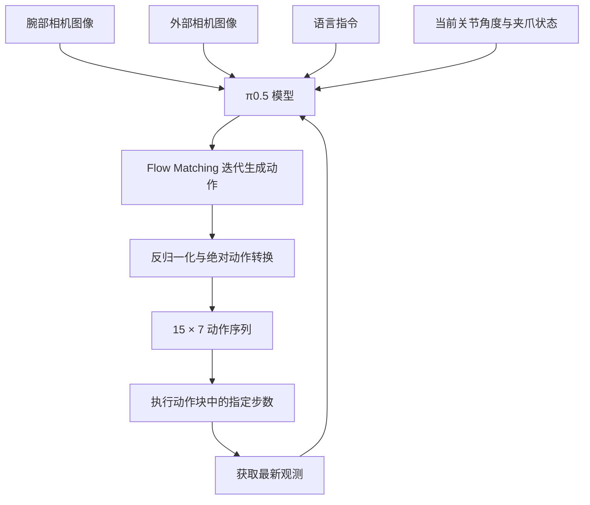

# RM65 π0.5 模型推理原理与 asset_id

记录日期：2026-11-27

## 训练数据与模型身份

本次训练使用 11 月 24 日的 20 条和 11 月 26 日的 50 条黑色方块抓放示教轨迹，合并数据集共 70 条、37,753 帧，格式为 LeRobot v2.1。训练服务器部署的新模型报告 `model=merged70`、`checkpoint_step=9999`。

`asset_id` 标识训练时关联的数据资产，例如 checkpoint 中 `assets/<asset_id>/norm_stats.json`。归一化统计量记录状态与动作的数值分布，供模型输入归一化和预测输出反归一化使用。关节角度使用弧度，夹爪名义开度使用米。

本地推理客户端将 `--asset-id` 用于校验 WebSocket 服务报告的模型身份。远端服务负责加载 checkpoint 和对应的归一化统计量。该客户端参数只覆盖预期的标识值。

## 本次推理报错

| 元数据字段 | 本地要求 | 远端返回 |
|---|---|---|
| robot_type | rm65_hardware_eg2_4c2_nominal_width | 相同 |
| action_dim | 7 | 7 |
| action_horizon | 15 | 15 |
| fps | 30 | 30 |
| asset_id | local/lerobot-20261124-200236 | local/lerobot-20261126-merged |

新模型已正常返回元数据，但本地默认值仍指向旧训练数据集，因此元数据校验失败。在原有 CLI 推理命令中添加：

```bash
--asset-id local/lerobot-20261126-merged
```

默认值定义在 [RM65 策略配置](../../../configs/policies/rm65_cube_pi05.json)，校验逻辑位于 [rm65.py](../../../src/embodied/policy/remote/rm65.py)。

## π0.5 的训练与推理

π0.5 属于视觉、语言和动作（VLA）模型。本项目使用 LoRA 微调，使模型学习在视觉、语言和本体状态条件下，未来动作序列的分布。

| 输入 | 本项目内容 |
|---|---|
| 视觉 | 腕部与外部相机 RGB 图像 |
| 语言 | 把黑色方块放到白色盒子里 |
| 本体状态 | 六个关节角度与一个夹爪名义开度 |

训练数据提供实际关节位置和已提交的关节目标。模型适配配置对关节目标使用相对于当前状态的增量表示，夹爪使用绝对开度。训练通过 Flow Matching 学习在观测条件下从噪声到示教动作的转换。推理时从随机噪声开始，沿模型预测的向量场迭代计算动作序列，再进行反归一化和绝对动作转换，得到平台使用的七维目标。



远端服务每次返回一个 15 × 7 的动作矩阵，15 个时间步对应 30 Hz 下约 0.5 秒的预测时域。实际执行步数由推理配置决定。执行一段动作后重新获取图像和机器人状态，再生成下一段动作，形成闭环推理。方块位置发生变化时，模型可以根据新的视觉条件调整动作，实际泛化能力需要通过实验评估。

参考 [远端推理部署说明](../../guides/policy-remote.md) 和 [训练动作转换](../../../scripts/training/openpi/joint_contract.py)。
