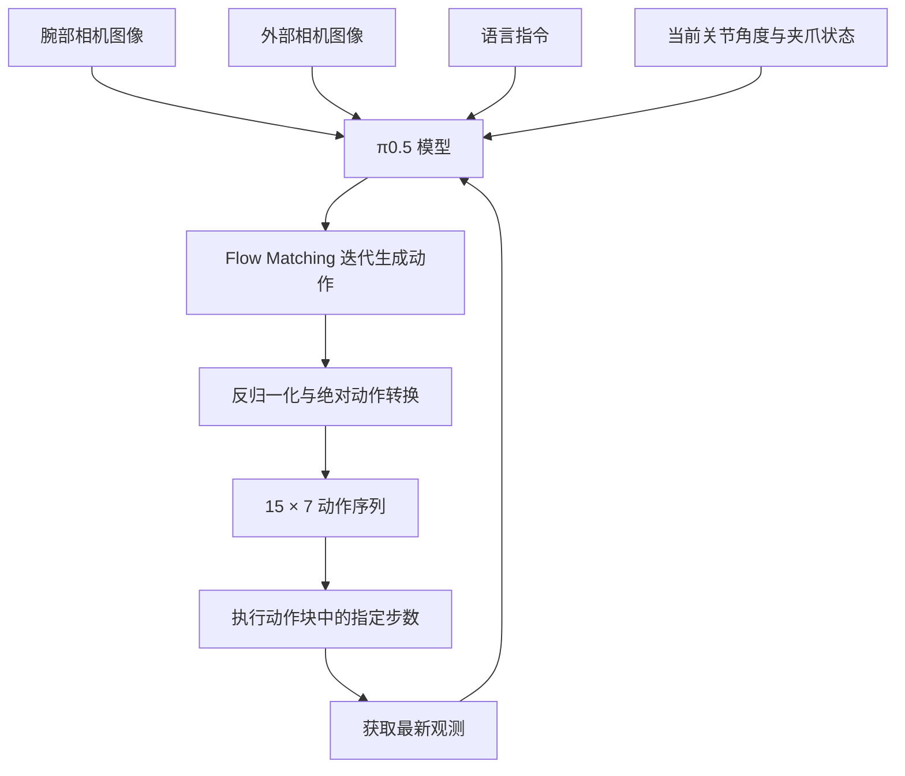

# RM65 π0.5 模型推理原理与 asset_id

记录日期：2026-11-27

## 训练数据与模型身份

本次训练使用 11 月 24 日的 20 条和 11 月 26 日的 50 条黑色方块抓放示教轨迹，合并数据集共 70 条、37,753 帧，格式为 LeRobot v2.1。训练服务器部署的新模型报告 `model=merged70`、`checkpoint_step=9999`。

`asset_id` 标识训练时关联的数据资产，例如 checkpoint 中 `assets/<asset_id>/norm_stats.json`。归一化统计量记录状态与动作的数值分布，供模型输入归一化和预测输出反归一化使用。关节角度使用弧度，夹爪名义开度使用米。

本地推理客户端将 `--asset-id` 用于校验 WebSocket 服务报告的模型身份。远端服务负责加载 checkpoint 和对应的归一化统计量。该客户端参数只覆盖预期的标识值。

## 本次推理报错

| 元数据字段 | 本地要求 | 远端返回 |
|---|---|---|
| robot_type | rm65_hardware_eg2_4c2_nominal_width | 相同 |
| action_dim | 7 | 7 |
| action_horizon | 15 | 15 |
| fps | 30 | 30 |
| asset_id | local/lerobot-20261124-200236 | local/lerobot-20261126-merged |

新模型已正常返回元数据，但本地默认值仍指向旧训练数据集，因此元数据校验失败。在原有 CLI 推理命令中添加：

```bash
--asset-id local/lerobot-20261126-merged
```

默认值定义在 [RM65 策略配置](../../../configs/policies/rm65_cube_pi05.json)，校验逻辑位于 [rm65.py](../../../src/embodied/policy/remote/rm65.py)。

## π0.5 的训练与推理

π0.5 属于视觉、语言和动作（VLA）模型。本项目使用 LoRA 微调，使模型学习在视觉、语言和本体状态条件下，未来动作序列的分布。

| 输入 | 本项目内容 |
|---|---|
| 视觉 | 腕部与外部相机 RGB 图像 |
| 语言 | 把黑色方块放到白色盒子里 |
| 本体状态 | 六个关节角度与一个夹爪名义开度 |

训练数据提供实际关节位置和已提交的关节目标。模型适配配置对关节目标使用相对于当前状态的增量表示，夹爪使用绝对开度。训练通过 Flow Matching 学习在观测条件下从噪声到示教动作的转换。推理时从随机噪声开始，沿模型预测的向量场迭代计算动作序列，再进行反归一化和绝对动作转换，得到平台使用的七维目标。



远端服务每次返回一个 15 × 7 的动作矩阵，15 个时间步对应 30 Hz 下约 0.5 秒的预测时域。实际执行步数由推理配置决定。执行一段动作后重新获取图像和机器人状态，再生成下一段动作，形成闭环推理。方块位置发生变化时，模型可以根据新的视觉条件调整动作，实际泛化能力需要通过实验评估。

参考 [远端推理部署说明](../../guides/policy-remote.md) 和 [训练动作转换](../../../scripts/training/openpi/joint_contract.py)。

## 网页启动时如何切换远端模型

网页通过策略进程启动 RM65 推理，每次启动都会读取 [rm65_cube_pi05.json](../../../configs/policies/rm65_cube_pi05.json) 中的 `asset_id`。无需在网页增加参数控件。

1. 在 GPU 服务器部署所选模型的 checkpoint，使用与该 checkpoint 匹配的归一化统计量。
2. 查看服务启动日志或客户端收到的 metadata，确认实际的 `asset_id`。
3. 修改本地配置中的 `asset_id` 一行，使其与远端报告完全一致。
4. 在网页重新启动推理，先勾选「只推理」验证连接、动作维度和时延。

例如，在远端使用合并的 70 条轨迹训练的模型时，本地配置为：

```json
"asset_id": "local/lerobot-20261126-merged"
```

如果部署只使用 11 月 26 日 50 条轨迹训练的模型，且远端报告的资产标识确实为以下值，则设置：

```json
"asset_id": "local/lerobot-20261126-only"
```

如果换回原来 20 条的模型，则配置为：

```json
"asset_id": "local/lerobot-20261124-200236"
```

实际值以远端 metadata 为准。同一训练资产上的不同 checkpoint 可以共享 asset_id。如果模型的机器人类型、动作维度、预测步数、相机语义或控制频率发生变化，也要确认模型接口与实际平台匹配。仅修改资产标识适用于接口相同的模型。

第一次元数据报错已通过修改配置解决。2026-11-27 的下一次启动日志已经输出 `event=connected`，其中包含 `model=merged70` 和正确的新 asset_id。

## 问题二：等待远端预测结果超时

### 出现场景

在网页启动新模型的真机推理，连接和元数据检查已成功。第一轮观测已保存，但等待服务返回动作时发生：

```text
TimeoutError: timed out in 1.5s
```

本次记录位于 `outputs/policy_remote/20261127-101900/`。其中 `summary.json` 显示 failed、cycles=0、chunks=0、commands=0，`cycle_0000/observation.json` 已生成，说明尚未收到可执行的预测动作。

### 原因与定位

- [RM65 远端入口](../../../src/embodied/policy/remote/rm65.py) 中调用 `RemotePolicy(args.server, timeout_s=1.5)`，设置了 1.5 秒的回复等待时间。
- [WebSocket 客户端](../../../src/embodied/policy/remote/client.py) 发送观测后调用 `recv(timeout=self.timeout_s)`。服务计算、排队、预处理、网络传输等都可能影响这段等待时间。
- 首次实际推理可能触发 JAX/XLA 编译或其他模型预热。也可能存在 GPU 忙碌、服务端异常、网络或 SSH 隧道传输延迟。目前本地记录只能确认未在期限内收到完整回复，尚无服务端耗时证据可确定具体原因。
- [动作执行循环](../../../src/embodied/policy/kernel_runner.py) 还有 `max_age_s=1.5` 的观测时效检查。30 Hz 下执行 15 步本身需要约 0.5 秒，因此要完整执行一个动作块，观测到预测返回的耗时应明显低于约 1 秒，留出观测采集、调度和执行开销。

### 处理步骤

1. 检查 GPU 服务器当前 RM65 模型服务的日志，关注本次第一次请求是否收到、何时完成、是否发生编译或错误。可在服务器执行 `nvidia-smi` 检查 GPU 利用率、显存和其他占用进程。
2. 等模型完成预热。若服务支持启动时预热，应使用与实际输入形状一致的观测完成预热，然后再启动网页推理。
3. 在网页勾选「只推理」，再次启动。成功收到动作后，日志会出现 `event=chunk` 和 `latency_ms`。记录连续多次时延，确认是否仅第一轮慢、后续稳定。
4. 若首轮仍超时，定位服务端实际推理是否成功及耗时。调试网络超时的代码位置是 rm65.py 中的 `RemotePolicy(args.server, timeout_s=1.5)`，可在隔离的只推理诊断中临时增加等待时间以观测回复，但执行循环仍会检查观测是否过期。实际控制必须满足现有观测时效要求。
5. 若远端持续计算慢，优先从 GPU 资源占用、模型推理后端、编译、预处理及传输链路降低时延。若观察到 `Action chunk observation is stale`，说明动作开始或执行期间的观测已超过时效限制，需要降低推理延迟并检查执行步数，而不是简单延长动作有效时间。

本次超时的服务端根因及恢复结果尚待服务端日志和只推理验证确认。
